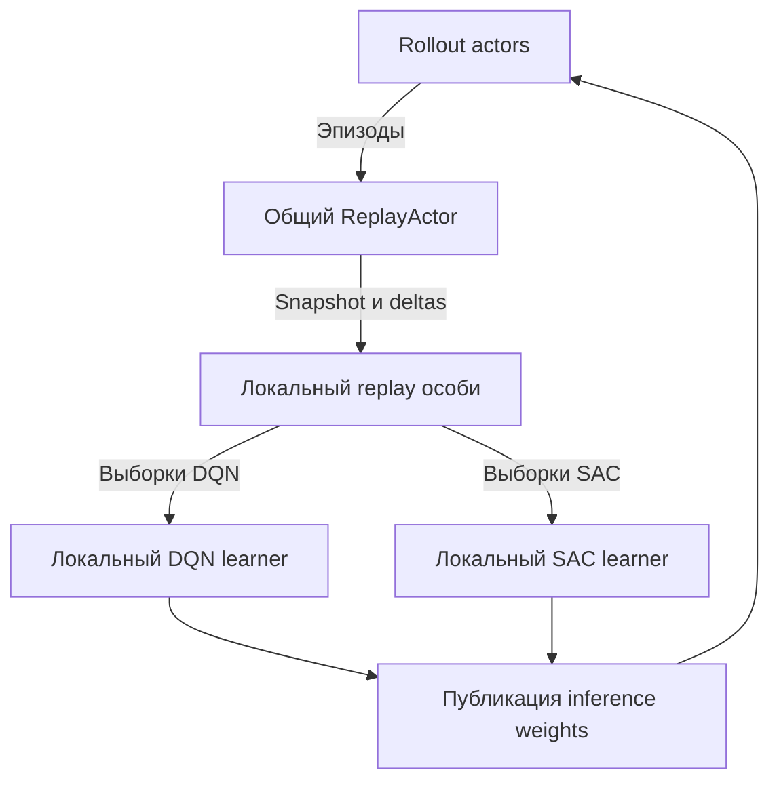

# Техническое задание: DQN, иерархические политики и графовые энкодеры

## 0. Паспорт документа

| Поле | Значение |
|---|---|
| Проект | `TovarnovM/rllib-async-runtime`, Python-пакет `rllib_async` |
| Рабочая ветка | `feature/dqn-hierarchy-gnn` |
| Версия ТЗ | 1.0 |
| Дата | 2026-11-14 |
| База разработки | `main`, commit `b4eaec642d2cfd8651e53b974bbd3860fc4851fd` |
| Состояние базы | PR #25 с исправлениями GNN-валидации и ускорением интеграционных тестов уже включён |
| Формат работы | Поэтапная реализация в этой ветке после отдельной команды начать разработку |
| Назначение текущего коммита | Только техническое задание; реализация перечисленных возможностей не заявляется |

Документ предназначен для локального ИИ-агента, разработчика и проверяющего.
Он описывает требуемое поведение, границы ответственности, проверяемые
контракты и условия завершения работы. Имена новых классов и файлов, приведённые
как ориентиры, не являются требованием создать их буквально.

Согласованные пользователем требования отделены от предложенных технических
решений и условных расширений. Неизвестные характеристики прикладной среды
перечислены в разделе 25. Их нельзя молча подменять ограничениями демонстратора.

Исходные архитектурные документы сохраняют силу для уже работающего runtime:

- [Архитектурная граница](ARCHITECTURE.md).
- [Первоначальный план реализации](IMPLEMENTATION_PLAN.md).
- [Единица replay](adr/0002-episode-replay-quantum.md).
- [Разреженная иерархия](adr/0012-sparse-hierarchy-and-module-replay.md).
- [Графовые политики](adr/0013-shared-ego-graph-policy.md).
- [Производительность](PERFORMANCE.md).

Новое ТЗ расширяет области DQN, смешанного обучения, последовательностей и
энкодеров. Оно не отменяет существующие гарантии доставки, восстановления,
backpressure и совместимости. При реализации изменения ранее принятого
контракта должны сопровождаться актуализацией соответствующего ADR.

## Содержание

1. [Цель и сценарии](#1-цель-и-сценарии).
2. [Зафиксированные решения и границы](#2-зафиксированные-решения-и-границы).
3. [Исходное состояние и разрывы](#3-исходное-состояние-и-разрывы).
4. [Термины и инварианты](#4-термины-и-инварианты).
5. [Целевая архитектура](#5-целевая-архитектура).
6. [Конфигурация политик](#6-конфигурация-политик).
7. [Контракт исходного опыта](#7-контракт-исходного-опыта).
8. [Общий replay и выборки](#8-общий-replay-и-выборки).
9. [Последовательности и физические чанки](#9-последовательности-и-физические-чанки).
10. [Иерархия и время](#10-иерархия-и-время).
11. [Графы и независимые энкодеры](#11-графы-и-независимые-энкодеры).
12. [DQN и Rainbow](#12-dqn-и-rainbow).
13. [SAC и критики](#13-sac-и-критики).
14. [Рекуррентность](#14-рекуррентность).
15. [Learner-host и расписания](#15-learner-host-и-расписания).
16. [Rollout и публикация весов](#16-rollout-и-публикация-весов).
17. [Checkpoint и восстановление](#17-checkpoint-и-восстановление).
18. [Популяция и PBT](#18-популяция-и-pbt).
19. [Производительность и сеть](#19-производительность-и-сеть).
20. [Проверки и тестовая матрица](#20-проверки-и-тестовая-матрица).
21. [Демонстраторы и оценка качества](#21-демонстраторы-и-оценка-качества).
22. [Этапы реализации](#22-этапы-реализации).
23. [Карта изменений в репозитории](#23-карта-изменений-в-репозитории).
24. [Приёмка и отчёт исполнителя](#24-приёмка-и-отчёт-исполнителя).
25. [Открытые прикладные решения](#25-открытые-прикладные-решения).
26. [Риски и ограничения](#26-риски-и-ограничения).
27. [Первичные источники](#27-первичные-источники).
28. [Порядок работы в ветке](#28-порядок-работы-в-ветке).

## 1. Цель и сценарии

### 1.1. Целевой результат

Расширить существующий асинхронный runtime так, чтобы одна особь могла содержать
несколько типов политик. Для каждой политики независимо задаются алгоритм
обучения, пространство действий, представление наблюдения и энкодеры.

Обязательные алгоритмы: DQN для `Discrete` и существующий SAC для `Discrete`
и непрерывного `Box`. Наблюдения могут быть векторными или графовыми.
Энкодеры actor, критиков и Q-сети могут иметь собственные параметры.
Для рекуррентных энкодеров обучение производится по последовательностям
исходного опыта с определённой процедурой получения начального состояния.

Несколько алгоритмов, политик и особей используют один авторитетный replay.
Хранение опыта не зависит от выбранной архитектуры нейросети. Обучаемые
представления вычисляются при обучении текущими весами соответствующей сети.

Runtime остаётся тонким слоем композиции Ray/RLlib. RLlib продолжает владеть
штатными алгоритмическими loss, optimizers и target networks там, где его
контракты позволяют реализовать требуемую семантику без подмены задачи.

### 1.2. Обязательные пользовательские сценарии

| ID | Сценарий | Проверяемый результат |
|---|---|---|
| UC-01 | Один DQN-агент с векторным наблюдением | Сбор, replay, обновление, evaluation и восстановление работают в основном runtime |
| UC-02 | Несколько однотипных агентов с общей графовой политикой | Одна политика обслуживает много `agent_id`; число сетей не растёт с числом агентов |
| UC-03 | Менеджер DQN выбирает исполнителя DQN или SAC | Одна среда, общий опыт, разные learners, корректная очередность решений |
| UC-04 | Графовые наблюдения у менеджера и исполнителей | Допускаются разные размеры графов и разные схемы признаков между модулями |
| UC-05 | У actor и критиков разные энкодеры | Градиенты, optimizers, targets и checkpoints принадлежат правильным сетям |
| UC-06 | Рекуррентный DQN либо SAC | Выбираются упорядоченные окна; состояния не смешиваются между агентами и сетями |
| UC-07 | Несколько особей с одним replay | Общие payload и retention; независимые веса, RNG, выборки и приоритеты |
| UC-08 | Остановка и восстановление смешанной системы | Сохраняются алгоритмические состояния, расписания, данные и идентичность потоков |
| UC-09 | Старый плоский SAC-сценарий | Поведение и существующие гарантии сохраняются без обязательной новой конфигурации |

### 1.3. Что означает успех

Успехом считается работа перечисленных сочетаний через основной runtime,
а не только создание моделей или один ручной `learner.update()` в примере.
Каждый обязательный сценарий должен иметь проверку правильности и короткий
воспроизводимый запуск. Проверка обучения отделяется от проверки транспорта.

Достижение лучшего reward по сравнению с SAC не предполагается заранее.
Эксперименты должны определить пользу DQN, графов и иерархии при сопоставимом
бюджете взаимодействия со средой и вычислений.

## 2. Зафиксированные решения и границы

### 2.1. Требования пользователя

| ID | Обязательное решение |
|---|---|
| REQ-01 | Один общий авторитетный replay для всех поддерживаемых алгоритмов |
| REQ-02 | Данные replay достаточны для динамического вычисления представлений разными энкодерами |
| REQ-03 | Допускаются отдельные энкодеры actor и каждого критика |
| REQ-04 | Поддерживаются дискретные политики DQN и смешанная иерархия через типы агентов |
| REQ-05 | Графовые наблюдения совместимы с поддерживаемыми типами политик |
| REQ-06 | Архитектура поддерживает выборку меньших последовательностей и определяет рекуррентное состояние |
| REQ-07 | Сохраняются локальная выборка, низкая сетевая нагрузка и отсутствие дорогих повторных проверок |
| REQ-08 | Решение использует существующие механизмы проекта и штатные возможности RLlib прежде новых абстракций |
| REQ-09 | Сохраняются корректность replay, порядок, воспроизводимость, восстановление и управление ресурсами |
| REQ-10 | Изменения развиваются в новой общей рабочей ветке |

### 2.2. Проектные решения этой версии ТЗ

Следующие решения предложены как рабочая основа реализации. Они не являются
ответами пользователя на ещё не заданные параметры прикладной среды.

| Решение | Рабочий вариант | Основание |
|---|---|---|
| Единица authoritative commit и eviction | Полный эпизод | Сохраняет действующие гарантии и всю доступную историю |
| Единица обучения | Transition либо локально выбранное окно | Не требует изменения транспорта для recurrent/n-step |
| Размещение learners | Один learner-host на особь; локальные группы по алгоритму | Общий локальный payload, существующее владение GPU |
| Веса rollout | Согласованный комплект всех модулей с одной версией публикации | Соответствует ограничению текущего `MultiAgentEnvRunner` |
| Первый иерархический пример | Один менеджер, два типа исполнителей, фиксированный период | Простая проверяемая причинность |
| Проверка переменной длительности | Второй режим той же среды с завершением стратегии по условию | Контракт времени должен работать за пределами фиксированного периода |
| Первая рекуррентная модель | Векторный энкодер или GNN, затем память на уровне агента | Проверяет temporal replay без сложного владения памятью узлов |
| Состояние для recurrent training | Полный префикс как эталон; ограниченный burn-in как явно приближённый режим | Совместимо с независимыми actor/critic/target encoders |
| Базовый GNN | Текущий PyTorch message passing | Новая зависимость пока не обоснована |
| Проверка качества | Поэтапно: фиксированные исполнители, затем совместное обучение | Разделяет ошибки интеграции и нестационарность задачи |

### 2.3. Обязательный объём и условные расширения

В обязательный объём входят независимые энкодеры, графы переменного размера,
графовый непрерывный SAC, DQN, маски дискретных действий, mixed-algorithm
runtime, последовательности, recurrent training, checkpoint и совместимость
с текущей популяцией. Rainbow-компоненты раскрыты отдельно в разделе 12.

Следующие возможности не входят автоматически в первый цикл разработки:

- Потоковый commit незавершённых эпизодов. Условие добавления: подтверждённая
  задержка из-за длинных эпизодов или требование непрерывной среды.
- Выбор произвольного узла/ребра как действия, если число кандидатов не
  укладывается в согласованный фиксированный `Discrete` с маской.
- Память, принадлежащая каждому узлу динамического графа.
- Новые семейства GNN, гетерографовые библиотеки и PyTorch Geometric.
- Один централизованный графовый forward сразу для всех политик и агентов.
- Общие обучаемые параметры между разными алгоритмами.
- Автоматическое открытие навыков, Option-Critic, HIRO/HER и переопределение
  прошлых целей в replay.
- Произвольные составные `Tuple`/`Dict`/`MultiDiscrete` action spaces.
- MPI, распределённый multi-GPU learner и DDP.

Исключение из первого цикла не должно маскироваться как реализованная поддержка.
Для неподдерживаемого сочетания нужна ранняя понятная ошибка конфигурации.

### 2.4. Правило минимальной реализации

До изменения кода изучаются владельцы поведения, все применимые callers,
state transitions, tests и failure/recovery paths. Затем по порядку выбираются:

1. Отказ от поведения, не требуемого текущими сценариями.
2. Повторное использование существующего helper, типа или контракта проекта.
3. Официальный primitive/extension point Ray или RLlib.
4. Стандартная библиотека Python либо установленная зависимость.
5. Минимальная прямая реализация.
6. Новая абстракция или зависимость только при доказанной необходимости.

Нельзя делать универсальную систему плагинов ради двух алгоритмов. Общая
граница адаптера оправдана двумя текущими потребителями, SAC и DQN; отдельные
регистраторы, фабрики фабрик и второй слой конфигурации требуют собственного
обоснования. Нельзя сокращать объём путём удаления обязательных сценариев.

## 3. Исходное состояние и разрывы

### 3.1. Проверенная база

База документа — дерево `3f77493fcdd3311f7b40fb2891f51c83bbdedc04`.
Фиксация SHA нужна для воспроизводимости анализа; при дальнейшем развитии
ветки необходимо указывать SHA фактически проверяемой реализации.

| Компонент | Состояние на базе ТЗ | Требуемое расширение |
|---|---|---|
| `EpisodeStore` / `ReplayActor` | Один владелец, immutable эпизоды, idempotency, FIFO, journal/deltas | Сохранить владение; расширить совместимые схемы данных |
| `FastReplay` | Локальная uniform-выборка transitions, module indexes, reader leases | Последовательности, независимые sampler states, локальный PER |
| `LearnerHost` | Привязан к `SACConfig`, `FlatEpisodeCodec`, `n_step=1` | Смешанные модули, graph/sequence batches, корректные horizons |
| `SACLearnerAdapter` | Штатный SAC loss; дополнения состояния alpha и target schedule | Частичные обновления модулей, необходимые encoder seams |
| `MultiModuleEpisodeRunner` | Разреженные ходы, полные эпизоды, одна публикационная версия | Включить в основной mixed runtime; сохранить причинность и время |
| Phase 9 | Менеджер `Discrete(2)`, два непрерывных исполнителя; все SAC | DQN-менеджер и смешанные алгоритмы |
| Phase 10 | Общая графовая SAC-политика для однородных агентов | Разные graph schemas, DQN и непрерывный SAC |
| `TorchGraphEncoder` | Stateless между шагами среды, pure PyTorch | Независимые конфигурации и temporal wrapper |
| `GraphEpisodeCodec` | Одна графовая схема на codec | Совместимые схемы по модулям и сочетание graph/vector |
| `GraphBatchCollator` | Упакованные независимые графы | Sequence masks, корректная работа с DQN forward |
| `PopulationTrainable` | Один Tune trial, shared replay, активные SAC-особи, простой PBT | Совместимые смешанные команды как особи |

### 3.2. Особенности закреплённого RLlib

На базе используются Python 3.11, Ray/RLlib 2.56.1, PyTorch 2.7.0,
NumPy 2.4.6. CPU и CUDA 11.8 extras остаются взаимоисключающими.
Локальная разработка и проектные проверки выполняются в repository-owned
devcontainer. Автоматическое обновление зависимостей в рамках этой задачи
не является решением проблемы совместимости.

По просмотренным исходникам Ray 2.56.1:

- DQN learner принимает `weights` и `n_step`, поддерживает Double DQN и C51.
- Стандартный Double DQN forward объединяет `obs` и `next_obs` обычной
  конкатенацией tensor leaves; это некорректно для нашего packed graph layout.
- `DQNCatalog` создаёт обычные MLP heads; наличие поля `noisy` в `DQNConfig`
  не подтверждает включение Noisy Networks в новом API-пути.
- Target schedule DQN использует переданный learner timestep; runtime обязан
  задать его смысл, особенно для редко действующего менеджера.
- Нельзя предполагать, что все schedule states автоматически входят в
  checkpoint. Это проверяется следующим обновлением после восстановления.

Эти наблюдения определяют обязательный compatibility gate. Они не заменяют
исполняемую проверку на закреплённом dependency set. Ссылки на исходники
приведены в разделе 27.

### 3.3. Не переписывать работающий runtime

Не требуется переносить проект на штатный `Algorithm.training_step()`.
Нельзя создавать отдельные управляющие контуры для SAC и DQN, повторно
собирать один опыт разными rollout groups или дублировать authoritative replay.
Старый single-module SAC-путь должен оставаться простым и работоспособным.

## 4. Термины и инварианты

### 4.1. Термины

| Термин | Смысл |
|---|---|
| Эпизод среды | Одна траектория мира от reset до termination/truncation |
| Логический агент | Участник протокола среды с собственной историей решений |
| Экземпляр агента | Конкретная жизнь агента; повторное появление не склеивается с предыдущей жизнью |
| Модуль/политика | Обучаемое поведение, обслуживающее один или несколько `agent_id` |
| Роль | Семантика наблюдений, действий, награды и задачи; не тождественна алгоритму |
| Особь | Полный совместимый набор политик одной команды с собственным learner state |
| Authoritative replay | Единственный источник истины о сохранённом опыте и retention |
| Локальное представление replay | Payload и индексы для обучения без RPC на minibatch |
| Окно обучения | Логический срез последовательности, выбираемый локально |
| Физический чанк | Порция передачи/commit; отдельное понятие от окна обучения |
| Граф наблюдения | Узлы, рёбра, признаки и семантика их интерпретации |
| Temporal recurrence | Состояние сети, переносимое между решениями агента |
| Publication epoch | Общий номер согласованного набора inference weights |
| Learner update counter | Счётчик обновлений конкретного модуля; не равен publication epoch |

### 4.2. Инварианты, сохраняемые на всех этапах

| ID | Инвариант |
|---|---|
| INV-01 | Один authoritative replay на запуск/популяцию, независимо от числа алгоритмов |
| INV-02 | У каждого записанного действия есть однозначные источник, агент, модуль и временная позиция |
| INV-03 | Неприменявшаяся политика не получает фиктивных transitions |
| INV-04 | Последовательность не склеивает разных агентов, жизни агента или эпизоды |
| INV-05 | Learned embeddings не подменяют исходные данные replay |
| INV-06 | Независимые actor/critic/target encoders не используют чужое recurrent state |
| INV-07 | Границы выборки и передачи не создают искусственный terminal |
| INV-08 | Обновление одного модуля не изменяет параметры и optimizer state другого без явного общего владения |
| INV-09 | Sampling, n-step preparation и PER update не требуют сетевого вызова на minibatch |
| INV-10 | Дорогие полные проверки содержимого не возвращаются в рабочий цикл после startup |
| INV-11 | Checkpoint связывает данные, конфигурацию, версии, learners, samplers и RNG |
| INV-12 | Inference publication не содержит optimizer state и learner-only target networks |
| INV-13 | Обработка пустой delta не запускает обход replay или перестройку индексов |
| INV-14 | Общая GPU особи резервируется один раз; локальные learners не создают скрытых GPU-акторов |
| INV-15 | Поддерживаемые сочетания перечислены явно; игнорирование неподдерживаемого флага запрещено |

## 5. Целевая архитектура

### 5.1. Владение компонентами



Диаграмма описывает потоки данных. DQN learner, SAC learner, локальный replay
и сборка публикации находятся внутри существующего learner-host одной особи.
Она не требует отдельного Ray actor на каждый блок диаграммы.

| Область | Владелец |
|---|---|
| Порядок ходов, задачи и награды | Среда / её существующий адаптер |
| Выполнение политик | RLlib EnvRunner и MultiRLModule |
| Долговременное владение опытом | Единственный ReplayActor |
| Локальные индексы и выборки | Learner-host / FastReplay |
| Loss и optimizers | Соответствующий штатный RLlib learner |
| Графовое кодирование и необходимые forward adaptations | RLModule/Catalog на поддерживаемых seams |
| Бюджеты обновлений и объединение публикаций | Learner-host |
| Асинхронное управление, backpressure и lifecycle | Существующий controller |
| Популяция и совместный checkpoint | PopulationTrainable |

### 5.2. Один host, несколько алгоритмов

Начальный вариант — локальная learner group для SAC-модулей и локальная
learner group для DQN-модулей. Обе группы живут в одном процессе особи и
используют одну выделенную GPU либо CPU. `num_learners=0` и фактическое
размещение проверяются compatibility test, а не предполагаются по названию.

Обновления внутри GPU особи сначала выполняются последовательно. Конкурентные
CUDA streams и параллельные градиентные шаги не являются обязательной частью
задачи. Они допустимы позднее только по профилю и без потери воспроизводимости.

Если групповая реализация не позволяет корректные clocks отдельных модулей,
допускаются отдельные локальные learners в том же host. Выбор должен быть
обоснован конкретным ограничением RLlib. Дополнительные удалённые learners,
копии replay и второе резервирование GPU недопустимы.

### 5.3. Минимальная граница адаптера

Общая граница должна покрывать только реальные операции:

- Построить learner и принадлежащие ему модули.
- Обновить непустое подмножество модулей с их batch и clocks.
- Получить inference state для публикации.
- Получить/восстановить полное состояние обучения.
- Применить явно разрешённую мутацию гиперпараметра.
- Освободить принадлежащие ресурсы.

Результат обновления содержит небольшую сводку и, при PER, локальные
sample handles с TD-errors. Последние не отправляются контроллеру.
Интерфейс не должен превращаться в альтернативный API всех алгоритмов RLlib.

## 6. Конфигурация политик

### 6.1. Обязательная информация

Для каждого `module_id` определяются алгоритм, роль/схема опыта, пространства,
encoder configuration, sampling mode и training budget. Существующие
`SACConfig`, `DQNConfig`, `RLModuleSpec` и `MultiRLModuleSpec` используются
прежде введения собственного формата конфигурации.

| Параметр | Контракт |
|---|---|
| `module_id` | Стабилен внутри совместимой конфигурации команды |
| Алгоритм | SAC или DQN; не выводится неявно из размерности observation |
| Observation schema | Тип, размерности, смысл признаков и версия |
| Action schema | Пространство, семантика индексов/координат, маски |
| Reward semantics | Определение награды и её временная привязка |
| Encoder specs | Независимые specs для реально существующих сетей |
| Sampling mode | Transition или sequence; uniform или PER |
| Clocks | Смысл sample count, update count, exploration time и target time |
| Trainability | Обучаемая или явно фиксированная политика |

Проверка статической совместимости выполняется до запуска rollout и
резервирования длительной кампании. Неизвестный ключ либо несовместимое
сочетание должно приводить к понятной ошибке, а не к молчаливому fallback.

### 6.2. Минимальная матрица поддерживаемых сочетаний

| Алгоритм | Действия | Вектор | GNN | Память после энкодера |
|---|---|---|---|---|
| DQN | `Discrete` | Обязательно | Обязательно | Обязательно |
| SAC | `Discrete` | Сохранить | Сохранить и расширить | Обязательно |
| SAC | Непрерывный `Box` | Сохранить | Обязательно | Обязательно |

Матрица задаёт конечный объём ТЗ, а не размер ежедневного CI. Полная
комбинаторика архитектур, distributional heads, PER и RNN не запускается
в каждой интеграционной проверке; обязательные пересечения заданы далее.

Для первой версии графовых политик действия остаются фиксированным `Discrete`
либо `Box`. Переменное число узлов наблюдения не меняет action space автоматически.

### 6.3. Sharing и независимость

Несколько агентов одной роли могут отображаться в одну политику. При этом
их hidden states и последовательности остаются раздельными.
Несколько политик могут пользоваться одним кодом GNN с разными параметрами.
Независимые критики могут иметь разные hidden dimensions и число слоёв.

Sharing обучаемых весов между SAC и DQN в обязательный объём не входит.
Нельзя случайно создать его передачей одного экземпляра `torch.nn.Module`
двум owners. Проверка владения параметрами должна обнаруживать такие случаи.

## 7. Контракт исходного опыта

### 7.1. Алгоритмически независимые данные

Replay хранит наблюдавшиеся факты. Параметры конкретного learner — `gamma`,
горизонт `n-step`, архитектура энкодера, текущие Q-values и приоритеты —
не должны необратимо изменять общий исходный опыт.

В частности, сохранение только уже дисконтированного возврата менеджера
недостаточно, если другой learner должен использовать тот же опыт с другой
`gamma`. Нужно сохранить исходную временную последовательность наград или
эквивалентное представление, позволяющее точно получить требуемый возврат.

ТЗ задаёт логический контракт. Оно не требует сразу нормализовать всё
хранилище в отдельные таблицы или заменить pickle codec. Сначала расширяются
существующие envelope/codec interfaces настолько, насколько это необходимо.

Если RLlib уже агрегировал награды между редкими ходами агента, исходные
награды нельзя восстановить разложением полученной суммы. Нужная временная
история фиксируется на границе среды/collector до такой агрегации через
подходящий существующий episode/connector seam. Проверка T-H04 должна
подтверждать правильность всего пути от `env.step()`, а не только helper,
которому тест вручную передал идеальную последовательность наград.

### 7.2. Метаданные эпизода

Используются существующие поля, если они уже выражают нужный смысл.
Новые поля добавляются только для недостающей информации.

| Информация | Требование |
|---|---|
| Идентификатор эпизода | Уникален с учётом producer generation; повторная доставка идемпотентна |
| Источник | Run/member/runner identity в рамках существующего протокола |
| Версия schema/codec | Позволяет reject несовместимого payload до обучения |
| Состав модулей | Фактически участвовавшие модули и их семантическая совместимость |
| Behavior publication | Набор inference weights, которым получен опыт |
| Шкалы времени | Смысл world ticks, runner calls и agent decisions |
| Границы | Reset, истинное завершение, truncation и окончательные наблюдения |
| Размеры | Закэшированные transition/byte counts, вычисленные при создании payload |

Число module parameters, tensor bytes и размеры полного Python object graph
не пересчитываются для каждого commit, sync или learner tick.

### 7.3. Запись решения агента

Запись должна позволять однозначно восстановить следующие данные:

| Данные | Назначение |
|---|---|
| `episode_id`, `agent_id`, `module_id` | Принадлежность истории |
| Порядковый номер решения | Непрерывная последовательность данного экземпляра агента |
| Время начала и следующего наблюдения | Длительность действия/стратегии в выбранной физической шкале |
| Observation и следующая observation | Входы с сохранённой семантикой, включая нужный контекст |
| Реально исполненное действие | Включая однозначное правило clipping/преобразования |
| Награды на интервале | Возможность пересчитать возврат для нужного discount |
| Terminal/truncation/subtask boundary | Разные события с разными bootstrap/reset rules |
| Маски допустимых действий | Текущая и следующая маски, если применимы |
| Goal/strategy context | Цель, с которой фактически действовал исполнитель |
| Behavior provenance | Версия публикации и при необходимости состава команды |

Одна запись может ссылаться на общие данные эпизода вместо копирования графа
или списка наград. Ссылка остаётся внутренней и не становится сетевым запросом.
Существующий layout с копиями допускается как промежуточный совместимый вариант,
если профилирование не выявляет существенную избыточность.

### 7.4. Три временные шкалы

- `env_t` текущего runner обозначает порядок вызовов среды. Нельзя автоматически
  считать его числом физических шагов мира после добавления отдельных
  управляющих ходов менеджера.
- `world_t` в логическом контракте обозначает физические ticks симуляции.
  Если он совпадает с `env_t`, отдельный массив хранить не нужно.
- `agent_t` обозначает реальные решения одного экземпляра агента.

Имена новых полей могут отличаться; смешивать смыслы счётчиков нельзя.
Для каждого учебного перехода известна положительная длительность в выбранной
шкале дисконтирования. Внутренний routing без продвижения мира не создаёт
самостоятельного нулевого перехода для обучения.

### 7.5. Схемы, роли и использование одним алгоритмом чужого опыта

Проверка совместимости выполняется по смыслу данных, а не только по форме
массивов. Одинаковый `Discrete(3)` не делает три разных набора команд
взаимозаменяемыми. Одинаковая длина признаков не гарантирует одинаковые единицы
измерения или порядок признаков.

Для текущих однородных population members достаточно существующего стабильного
`module_id` и общего schema contract. Дополнительный ключ роли нужен только
когда конкретный сценарий требует чтения одной истории разными module IDs.
Не создавать произвольный query language для replay.

DQN и дискретный SAC могут читать одни и те же transitions при совпадении
наблюдений, действий, награды и termination semantics. DQN не читает
непрерывные действия без отдельно согласованного преобразования задачи.

### 7.6. Один граф и несколько представлений

Если разные consumers используют общий исходный граф, он может храниться
один раз с локальными selectors: управляемый узел, подграф, разрешённые признаки.
Если из сохранённых данных представление не восстанавливается, нужные поля
должны быть включены в payload при сборе.

Глобальные сведения для централизованного критика не следует искусственно
придумывать или делать обязательными для среды. Но при их наличии и использовании
они сохраняются явно. Inference actor не должен случайно получать привилегированную
информацию через общий tensor tree.

### 7.7. Версионирование и legacy data

Новые обязательные поля вносятся с новой schema version. Старый плоский
одношаговый переход может быть прочитан с `duration=1`, если это следует из
его прежнего контракта. Старому разреженному иерархическому переходу нельзя
приписывать физическую длительность или восстановленные награды без доказательства.

Неподдерживаемая миграция завершается ошибкой с указанием недостающих полей.
Не допускается тихое превращение старой суммы наград в якобы точный SMDP-return.
Проверки выполняются до изменения live state при restore.

## 8. Общий replay и выборки

### 8.1. Сохранить существующее владение

Authoritative replay остаётся единственным владельцем commit order, payload
retention, deduplication и journal. Learners не удаляют authoritative данные
из-за своих приоритетов, batch sizes или временного отсутствия интереса.

В одной особи local payload синхронизируется один раз и используется всеми
её algorithms/modules. На разных узлах допустимы локальные replicas; это
не отдельные источники истины. Доставка в каждый learner-host необходима,
но повторная доставка в каждую локальную learner group — нет.

Сохраняются reader leases: FIFO eviction не инвалидирует уже выбранный batch
или sequence. Новый sampling view публикуется атомарно; неудачная перестройка
не заменяет исправный active view.

### 8.2. Uniform transition sampling

Выборка выполняется равномерно по допустимым transitions конкретного модуля,
а не равномерно по эпизодам. Эпизод в сто раз длиннее должен давать в сто раз
больше допустимых стартовых transitions при одинаковом фильтре.

Индекс хранит координаты/ссылки и агрегированные длины. Не создавать отдельный
список копий observations для каждого алгоритма, критика или module view.
Существующий reference sampler расширяется как correctness oracle.

### 8.3. Uniform sequence sampling

Базовая единица равномерности — допустимая стартовая позиция обучаемого окна
в истории конкретного агента. Частота длинных и коротких эпизодов определяется
числом таких позиций. Решение о padding короткого хвоста задаётся явно.

Предлагаемый контракт:

1. Выбрать совместимый module view.
2. Выбрать `(episode_id, agent_instance, learn_start)`.
3. Локально получить prefix, обучаемый участок и target continuation.
4. Вернуть реальные длины, loss/validity masks и устойчивый sample handle.
5. Вычислить model-dependent representations в learner.

Запрещено продолжать окно следующим эпизодом или следующим агентом с тем же
`module_id`. Агенты с общей политикой остаются независимыми последовательностями.
Порядок внутри окна сохраняется даже при перемешивании самих окон.

### 8.4. Короткие эпизоды и хвосты

Короткие последовательности не должны приводить к бесконечному ожиданию
минимальной длины. Допускаются укороченное окно и padding для батчинга.
Padding не участвует в loss, PER aggregation, sample counters и метриках
реального количества решений.

При `n-step` около конца эпизода используется фактически доступный горизонт
и правильный terminal/bootstrap mask. Недостаток истории не восполняется
синтетическими нулевыми наградами как будто они получены из среды.

### 8.5. PER принадлежит learner

Authoritative payload остаётся одинаковым для uniform и prioritized sampling.
Приоритет хранится локально по паре consumer и sample identity. Consumer —
обучаемая политика конкретной особи; одинаковый опыт может иметь разные
приоритеты у двух learners.

Минимальная идентичность sample включает generation replay, episode ID,
идентичность истории агента и стартовую позицию. Для sequences дополнительно
учитывается sampling contract, если он изменяет смысл приоритета.

Требования к PER:

- Sampling probabilities и importance weights определяются на том же наборе
  элементов, на котором определены приоритеты.
- Начальный приоритет нового элемента положителен; правило детерминировано.
- TD-errors возвращаются в том же соответствии с sample handles, что и batch.
- Повторяющиеся sample handles в batch агрегируются по явному правилу.
  Базовый вариант — максимум абсолютной ошибки среди повторов.
- Поздний priority update для уже удалённого элемента игнорируется без
  возвращения элемента в replay и без изменения другого элемента.
- При смене generation старые handles не применяются.
- При `alpha=0` распределение согласуется с uniform oracle.
- Переходы и окна с нулевой loss mask не обновляют приоритет.

Для sequence priority базовый вариант — максимум абсолютной ошибки по
валидным обучаемым позициям. Другой reducer допускается по результату
compatibility/quality проверки с явно зафиксированным смыслом.

Вероятность sequence sampling относится к старту окна. Importance weight
этого окна применяется к его валидным обучаемым позициям; prefix и padding
исключаются. Нормировка loss и используемая базовая мера должны быть описаны
и проверены на окнах разной длины. Равномерность starts нельзя выдавать за
равномерность всех отдельных transitions: перекрытия и хвосты меняют частоту
попадания позиции в loss. Существующее поведение RLlib по применению PER
weights к actor/critic losses сохраняется либо изменяется только явно,
с обоснованием и numerical test.

Прежде собственного дерева приоритетов изучить установленные RLlib utilities.
Переиспользование не должно навязывать вторую копию payload или терять
существующие FIFO/delta/lease contracts. Новая библиотека для segment tree
без доказанной необходимости запрещена.

### 8.6. Retention и голодание редких ролей

Изначально сохраняется общий FIFO. Редкий менеджер имеет собственный индекс
и training budget, но это не создаёт отдельную retention policy.
Пример обязан показать, что его данные не вытесняются раньше первого
допустимого обновления при выбранной ёмкости.

Квоты по ролям, отдельные replay reservoirs и сложное lineage-aware mixing
не входят автоматически. Они добавляются только при измеренном голодании
прикладного сценария и отдельном описании изменившейся sampling distribution.

## 9. Последовательности и физические чанки

### 9.1. Обязательные окна обучения

Окно обучения существует как локальное представление сохранённого эпизода.
Оно не является новым authoritative объектом и не требует повторной передачи
эпизода по сети. Перекрывающиеся окна переиспользуют исходные данные.

| Часть окна | Назначение | Участие в loss |
|---|---|---|
| Prefix | Получить recurrent state каждого encoder | Нет |
| Learning segment | Обновить обучаемую сеть | Да, только валидные позиции |
| Target continuation | Вычислить следующий state и n-step targets | Нет самостоятельного loss, если позиция вне learning segment |

Размеры этих частей не должны быть одним неявным числом `sequence_length`.
Можно использовать существующие параметры RLlib, если их смысл документирован
и протестирован. Не требуется добавлять новый флаг для каждой внутренней длины.

### 9.2. Что не является основанием для физического дробления

Наличие GNN, графов разных размеров, RNN или `n_step>1` само по себе не требует
изменения authoritative commit unit. Эти возможности реализуются поверх
полных эпизодов. Статическая топология может храниться один раз внутри эпизода
без изменения commit/eviction semantics.

### 9.3. Условия открытия streaming extension

До добавления потокового commit измерить:

- Продолжительность эпизода в world ticks и wall-clock seconds.
- Максимальный и типичный размер эпизода в байтах.
- Задержку от получения перехода до доступности в learner.
- Peak memory producer и размер сетевого всплеска при завершении.
- Долю времени learner без свежих допустимых данных.

Streaming extension обоснован, если ожидание полного эпизода нарушает
согласованный бюджет задержки или памяти, либо среда не имеет естественного
конца. Порог определяется на целевой задаче; произвольное число шагов не
объявляется универсальной границей.

### 9.4. Контракт расширения, если оно понадобится

До реализации streaming необходимо отдельным ADR определить:

1. Идентичность `(episode_id, chunk_index)` и диапазон временных позиций.
2. Append-only порядок, идемпотентность, duplicate conflicts и обнаружение gaps.
3. Правило finalization и доступность незавершённых targets.
4. Условия удержания prefix для рекуррентных consumers.
5. Eviction неполного эпизода и взаимодействие с reader leases.
6. Восстановление после потери runner и судьбу последнего недоставленного чанка.
7. Обратную совместимость checkpoint и отсутствие искусственных terminals.
8. Backpressure, максимальный объём pending chunks и отсутствие busy polling.

Перекрытия burn-in не передаются заново: окна собираются локально по
неперекрывающимся исходным данным. Смена весов посреди эпизода не становится
разрешённой автоматически после дробления транспорта.

Если prefix удалён, нельзя заявлять точное восстановление состояния нового
recurrent encoder. Нужно либо сохранить историю, либо явно использовать
приближённый режим, либо отказать в такой выборке. Чанк с сохранённым hidden
state одной сети не решает эту задачу для независимых критиков.

## 10. Иерархия и время

### 10.1. Типы иерархии

Различать два случая:

- Факторизованный выбор внутри одного физического шага: выбрать тип действия,
  затем его параметры.
- Временная иерархия: выбрать стратегию, исполняемую несколько физических шагов.

Первый демонстратор этого ТЗ использует временную иерархию. Контракты не должны
делать несколько API turns равными нескольким физическим шагам без оснований.
Автоматическое разворачивание произвольного дерева action spaces не требуется.

### 10.2. Причинность принятия решений

Новый manager/worker пример должен соблюдать порядок:

1. Менеджер получает наблюдение и выбирает стратегию/роль.
2. Среда включает выбранную цель в наблюдение нужного исполнителя.
3. Исполнитель вычисляет действие уже с этой целью.
4. Мир делает физический шаг.
5. По окончании стратегии менеджер получает результат своего выбора.

Текущий Phase 9 пример намеренно применяет выбор менеджера к следующему ходу
исполнителя. Его нельзя молча считать примером другой причинности. Старый
пример сохраняется либо явно обновляется вместе с тестом и документацией.

### 10.3. Активные агенты и жизненный цикл

Среда возвращает observation только агентам, от которых требуется действие.
Пассивный агент может получать награды, относящиеся к его незавершённому
решению, но не получает искусственных действий и replay rows.

У каждой роли определены начало, окончание, reset и повторная активация.
Если вызов исполнителя трактуется как новая конечная подзадача, он получает
новый логический instance identity либо эквивалентную явную границу истории.
Один stable policy ID может обслуживать все такие экземпляры.

Для первого демонстратора: каждый завершённый вызов исполнителя является
завершённой локальной подзадачей, его recurrent memory сбрасывается при новом
вызове; менеджер сохраняет память до конца world episode. Это проектный
default примера, а не обязательная семантика всех пользовательских сред.

Если прикладной исполнитель сохраняет память между активациями, его история
должна это выражать. Пауза не равна terminal; смена goal включается в observation.
Нельзя автоматически переиспользовать hidden state другого экземпляра агента.

### 10.4. Награда и дисконтирование

При базовом discount на физический шаг переход длительностью `tau` имеет:

$$
R_t = \sum_{j=0}^{\tau-1}\gamma^j r_{t+j+1},\qquad
y_t = R_t + \gamma^{\tau} b_t V(s_{t+\tau}).
$$

Здесь `b_t` — явно вычисленный bootstrap mask. Для настоящего terminal он
равен нулю. Для time-limit truncation bootstrap сохраняется, когда существует
корректное конечное наблюдение и задача продолжается за искусственной границей.

Для Double DQN `V` вычисляется выбором допустимого действия online-сетью
и оценкой этого действия target-сетью. Для SAC используется соответствующий
штатный soft-value target. Reward aggregation выполняется до learner loss.

Если горизонт объединяет `m` решений с длительностями `tau_0 ... tau_(m-1)`,
то итоговый возврат складывает интервальные награды с discount по накопленной
длительности, а bootstrap использует `gamma` в степени суммы этих длительностей.
Решения разных агентов никогда не входят в одну такую цепочку.

### 10.5. Decision horizon и discount exponent

`n_step` как число решений sampling horizon и `tau` как число физических ticks
не являются одним понятием. В стандартном learner поле `n_step` может
использоваться в выражении `gamma ** n_step`. Адаптер вправе передать туда
фактический discount exponent, только если отдельно сохранён и проверен
смысл горизонта выбора данных.

Совместимость проверяется численным oracle для:

- Одного физического шага.
- Стратегии постоянной длительности.
- Стратегий разной длительности в одном batch.
- Нескольких решений менеджера в одном n-step target.
- Terminal и truncation до номинального конца горизонта.

Базовый runtime использует целочисленные физические ticks. Произвольное
непрерывное время и per-transition discount factors сверх этого контракта
не требуются для первого цикла.

### 10.6. Окончание стратегии и завершение задачи

| Событие | Менеджер | Исполнитель |
|---|---|---|
| Стратегия закончилась, мир продолжается | Получает следующий state, bootstrap допустим | Зависит от объявленной семантики локальной подзадачи |
| Истинный terminal мира | Нет bootstrap | Нет bootstrap |
| Искусственный time limit | Используется реальное final observation по контракту truncation | Аналогично, если подзадача не терминальна |
| Граница training window | Не меняет задачу | Не меняет задачу |
| Граница физического чанка | Не меняет задачу | Не меняет задачу |

Не использовать reset observation нового эпизода в качестве конечного
наблюдения старого. Конечные состояния не обязаны иметь допустимые действия,
если bootstrap отсутствует; этот случай обрабатывается до masked reduction.

### 10.7. Нестационарность исполнителей

Во время совместного обучения меняется поведение исполнителей, поэтому старый
опыт менеджера получен в другой динамике. Это ограничение постановки, а не
ошибка, автоматически исправляемая off-policy свойством DQN/SAC.

Обязательны два режима проверки: обучение менеджера при фиксированных
исполнителях и совместное обучение. Behavior provenance сохраняется.
Размер/возраст replay и отношение частот обновления уровней фиксируются
в отчёте. HIRO-подобные correction/relabeling не добавляются без отдельной
исследовательской необходимости.

## 11. Графы и независимые энкодеры

### 11.1. Общий формат графа

Повторно использовать существующие поля `node_features`, `edge_index`,
`edge_features`, `controlled_node`, `node_count`, `edge_count` и `action_mask`
там, где сохраняется их смысл. Padded представление на границе Gymnasium
не должно становиться обязательным форматом хранения replay.

Графы одного batch могут иметь разные числа узлов и рёбер. Совместимость
определяется схемой признаков и поддерживаемой семантикой. Топология не обязана
быть одинаковой ни между примерами, ни между соседними моментами времени.

Обязательные крайние случаи: один узел, отсутствие рёбер, разные размеры
текущего и следующего графов, разные размеры графов в одной sequence.
Пустой граф не поддерживается автоматически: его смысл и способ получения
representation должны быть определены отдельно. Для первой версии требуется
хотя бы один узел.

### 11.2. Несколько graph schemas в одном replay

Текущий единый `GraphEpisodeCodec` с фиксированными dimensions недостаточен
для произвольного сочетания vector manager и graph workers либо разных
graph feature dimensions. Расширение должно задавать schema по совместимой
роли/модулю и сохранять общий эпизод и общий authoritative store.

Выбор schema/decoder делается по заранее проверенной конфигурации. Необходимо
избежать определения типов через глубокий обход payload на каждом sampling.
После startup используются подготовленные codec/collator paths.

### 11.3. Packed batching

При объединении графов должны корректно изменяться:

- Смещения узлов для каждого `edge_index`.
- `graph_ptr`, без лишних повторных граничных элементов.
- Индексы управляемых узлов.
- Привязка edge features и action masks.
- Соответствие графа позиции `(batch, time)` для последовательностей.

Нельзя применять обычный `torch.cat` ко всем leaves двух packed batches.
Объединение `obs` и `next_obs` для Double DQN либо использует корректную
операцию для packed graphs, либо выполняет отдельные forward passes.
Выбрать более простой корректный вариант, затем измерить его стоимость.

Упаковка не создаёт рёбра между разными примерами. При добавлении recurrence
время представляется отдельно; оно не становится неявной связью между
узлами соседних графов.

### 11.4. Encoder configurations

Для actor/Q-network, каждого critic и target counterpart допускаются
собственные архитектурные параметры. Target counterpart имеет структуру,
совместимую со своей online-сетью, но собственные значения параметров.

Базовый набор для GNN: размер проекции, число message-passing layers,
размер выходного representation и readout. Для первой версии достаточно
существующей mean aggregation; произвольный набор GAT/GIN/GraphTransformer
не требуется.

Readout должен покрывать два текущих использования:

- Представление управляемого узла с контекстом графа для исполнителя.
- Представление графа для менеджера, если у него нет естественного
  `controlled_node`.

Не вводить фиктивный узел исключительно ради обхода жёстко зашитого readout,
если небольшой явный global-pooling вариант решает задачу проще.

### 11.5. Сырые данные и вычисление representations

Обучаемые embeddings не являются авторитетным содержимым replay. Изменение
весов энкодера должно менять вычисляемое представление старого опыта без
перезаписи replay и рассылки новых payload.

Разделяемые операции: декодирование исходных полей, подготовка индексов,
упаковка topology, перенос совместимых входов на GPU. Представления разных
сетей вычисляются раздельно, если их параметры различаются.

Внутри одного update допустимо повторно использовать результат одной и той
же сети, если совпадают входы, параметры, stochastic context и требования
autograd. Нельзя кэшировать learned embedding между optimizer steps без
явной политики invalidation. Такой межшаговый кэш в первую реализацию не входит.

### 11.6. Проверка владения градиентами

Для отдельного actor encoder и двух critic encoders требуется доказать:

1. Их parameters не являются одним объектом и не перекрываются неожиданно.
2. Critic update изменяет соответствующие critic параметры.
3. Actor update даёт actor градиент через оценку действия, но не выполняет
   optimizer step критика и не изменяет его optimizer state.
4. Target parameters не получают optimizer updates.
5. Hard/soft target update включает encoder weights.
6. Изменение параметров одной сети не меняет другую до предусмотренного
   target update или явно выбранного sharing.

### 11.7. Граф и пространство действий

Основной режим DQN выдаёт фиксированное число Q-values для `Discrete(n)`.
Граф переменного размера не означает переменное число выходов Q-head.
Для ограниченного числа команд используются фиксированные индексы и маска.

Если прикладная задача требует выбрать произвольный узел/ребро, нужен
отдельный контракт candidate actions: идентичность кандидата, признаки,
маска и отображение выбранного индекса в действие среды. В такой задаче
может потребоваться node/edge scoring head. Его нельзя выдавать за уже
полученную возможность после подключения graph encoder.

## 12. DQN и Rainbow

### 12.1. Базовый DQN adapter

Добавить адаптер штатного DQN learner по образцу существующего SAC adapter.
Алгоритмический loss не копируется в проект ради удобства интеграции.
Обязательны vector и graph observations, обучение на CPU и внутри GPU host.

Входной batch содержит корректно подготовленные observations, next observations,
integer actions, rewards/returns, terminal masks, фактический discount exponent
и importance weights. Uniform sampling передаёт единичные weights.

Нужен fixed-batch parity test со штатным RLlib learner при одинаковых весах,
RNG и параметрах. Сравниваются loss, update параметров и target behavior
с допускаемой погрешностью соответствующего dtype/device.

### 12.2. Требуемые компоненты семейства DQN

| Компонент | Требование | Основной владелец |
|---|---|---|
| DQN | Обязателен | RLlib learner |
| Double DQN | Обязателен | RLlib loss и корректный module forward |
| Dueling heads | Обязательны | RLlib catalog/module |
| C51 | Обязателен к завершению этапа 3 | RLlib distributional loss/head |
| Multi-step targets | Обязательны | Локальная подготовка replay batch |
| PER | Обязателен | Локальный sampler и RLlib weighted loss |
| Noisy Networks | Проверяемая цель полного Rainbow, с отдельным compatibility gate | Штатная поддержка либо минимальное обоснованное расширение |

Результат не называется полным Rainbow, пока не работают все заявленные
компоненты совместно. Если Noisy остаётся заблокирован конкретным ограничением,
отчёт должен назвать готовый набор компонентов и blocker; полная приёмка
Rainbow остаётся незакрытой. Молчаливое игнорирование `noisy=True` запрещено.

### 12.3. Noisy Networks и закреплённая версия

На Ray 2.56.1 выполнить исполняемую проверку: меняется ли exploration
из-за parametric noise, создаются ли noise parameters и обучаются ли они.
Наличие поля в конфигурации или ненулевого `sigma0` не является проверкой.

Если штатный новый API не предоставляет поддержку, последовательно оценить:

1. Уже установленный совместимый RLlib primitive/extension point.
2. Небольшой module/head extension с сохранением штатного DQN loss.
3. Отдельное обновление Ray, только если оно уменьшает суммарную сложность
   и проходит полный существующий compatibility suite.

Не переносить весь алгоритм на старый API stack и не обновлять Ray скрыто
в большом архитектурном коммите. При расширении Noisy head определить reset
noise, training/evaluation behavior, RNG/checkpoint и взаимодействие с epsilon.

### 12.4. Exploration и маски

Для каждого модуля exploration schedule имеет определённый clock и
сохраняемое состояние. Рабочий default — накопленное число реальных решений
этой политики внутри runner, суммарно по её активным агентам, как уточнено
в разделе 15.4. Решения другого модуля не
должны автоматически исчерпывать epsilon schedule менеджера.

Требуется проверить:

- Greedy action всегда допустим.
- При `epsilon=1` случайный выбор ограничен допустимыми действиями.
- Допустимое действие с Q-value, равным ровно нулю, остаётся доступным.
- Нулевая и одинаковая инициализация Q-head не ломают exploration.
- Evaluation выключает exploration согласно выбранному режиму.
- После restore clock не начинается заново.

Маска применяется и при выборе следующего действия в target. Для Double DQN
online argmax ограничен допустимыми действиями, target оценивает выбранное.
Для C51 выбор действия также производится по допустимым expected Q-values;
распределение выбранного действия участвует в штатном projection.

Состояние без допустимых действий допустимо как terminal без bootstrap.
Нетерминальное состояние с пустой маской — ошибка среды/контракта.
Не допускать NaN из `0 * -inf` или редукции по полностью замаскированной строке.

### 12.5. C51

Сохранять параметры `num_atoms`, `v_min`, `v_max` в конфигурации и checkpoint.
Диапазон support должен соответствовать масштабу возврата прикладной задачи.
Фиксированный диапазон из примера не объявляется подходящим для всех сред.

Проверить projection при terminal, variable duration и n-step, нормировку
вероятностей и отсутствие NaN. Изменение числа atoms несовместимо с точным
resume старого checkpoint. Изменение support требует явной политики warm start,
а не автоматического продолжения.

### 12.6. Target updates и TD-errors

Target schedule не привязывается неявно к общему `env_t`. У каждого модуля
есть определённая шкала и сохранённая последняя позиция обновления.
Переход `gamma ** exponent` должен соответствовать той шкале, в которой
собрана награда, независимо от clock обновления target.

TD-errors для PER извлекаются локально один раз на batch в проверенном
соответствии с samples. Для C51 используется документированный сигнал
приоритета штатного learner либо явно проверенное согласованное правило.
Нельзя смешивать absolute TD-error и distributional loss под одним
необъяснённым именем в отчёте.

## 13. SAC и критики

### 13.1. Сохранить действующий алгоритм

Плоский SAC должен продолжать работать через существующие команды и
конфигурации. Сохраняются temperature state, twin critics, target updates,
optimizers и порядок восстановления. Нельзя переписать SAC loss для
унификации с DQN, если требуемые изменения относятся к данным или forward.

### 13.2. Непрерывный SAC с графом

Actor кодирует observation graph и выдаёт параметры распределения действий.
Critic оценивает `Q(observation, action)`: информация о действии обязательна.
Простое снятие проверки `Discrete` из текущего каталога недостаточно.

В Ray 2.56.1 `SACCatalog` предоставляет `build_qf_encoder()` и использует
multi-stream подход для observation/action. Сначала проверить этот seam
с нашим graph encoder; собственная композиция нужна только для оставшегося
конкретного ограничения, например разных размеров twin critics.

При неизменном графе и двух разных действиях тест должен подтверждать,
что critic способен выдавать разные оценки и имеет корректный action gradient.
Bounded action transformation и scaling сохраняют штатную SAC-семантику.

### 13.3. Разные encoder specs для actor, Q1 и Q2

Обязательна возможность независимых параметров. Также проверить хотя бы
одну конфигурацию с разными hidden dimensions actor и critics и одну
конфигурацию с различающимися Q1/Q2 encoder specs.

Если штатный catalog не различает вызовы создания Q1 и Q2, использовать
минимальное явное module construction extension. Не определять номер критика
через нестабильный счётчик случайных вызовов build method.

Target critic строится по spec соответствующего online critic. При публикации
rollout передаётся только необходимая actor часть; независимые critics не
должны умножать размер inference publication.

### 13.4. Дискретный SAC и маски

Сохраняется существующий discrete SAC. Если включена action mask, она должна
влиять на sampling, policy probabilities, entropy и soft target expectation.
Недопустимые действия не входят в сумму ожидаемого Q.

`target_entropy` задаётся осмысленно для маскированного пространства.
Базовый вариант может использовать явно выбранную постоянную цель на роль;
нельзя автоматически считать все `n` действий доступными в каждом state.
Состояние с одним допустимым действием должно иметь конечные loss/alpha updates.
State-dependent entropy target не добавляется без необходимости и подходящего
learner seam.

### 13.5. Recurrent SAC — отдельный compatibility gate

В просмотренном `DefaultSACTorchRLModule` Ray 2.56.1 forward path не передаёт
recurrent state так, как требуется новой задаче. В просмотренном SAC loss
нет обработки sequence loss mask. Поэтому поддержка RNN не считается
полученной установкой `use_lstm` или заменой encoder class.

Сначала проверить возможность сформировать последовательный forward,
а затем передать штатному loss только соответствующие валидные обучаемые
позиции. Если этого недостаточно, минимально расширить нужную RLlib-границу,
сохранив формулы SAC и тест parity для нерекуррентного случая.

Любое изменение loss/reduction допустимо только после демонстрации
ограничения существующего API и должно иметь численный oracle. Нельзя
объявить RNN поддержанной, если padding или burn-in участвуют в loss.

## 14. Рекуррентность

### 14.1. Минимальная обязательная архитектура

В первой реализации temporal memory принадлежит агенту после получения
representation observation. Для вектора это encoder + recurrent core;
для графа — GNN/readout + recurrent core. Достаточно одного стандартного
типа памяти, например GRU; каталог всех RNN/SSM не требуется.

Temporal core может иметь разные параметры у actor, Q1, Q2 и target critics.
Рекуррентная поддержка должна быть проверена для DQN, discrete SAC и continuous
SAC. Полный дорогой Cartesian product всех вариантов не нужен в daily CI.

### 14.2. Кому принадлежит состояние

Hidden state идентифицируется экземпляром агента, конкретной сетью и
необходимой context boundary. Общие policy weights не означают общую память.
При обучении каждый encoder восстанавливает состояние своими актуальными
параметрами на доступной исходной истории.

Rollout хранит память только inference-сетей. Он не обязан запускать critics
ради сохранения их states. Сохранённый actor state нельзя передавать critic,
target network или другой архитектуре в качестве универсального `h0`.

Для базового режима состояние продвигается на реальных решениях данного
агента. Если прикладная модель должна обновлять память каждый world tick,
включая неактивные периоды, такие observations должны присутствовать в исходной
истории; это отдельный clock contract, а не скрытое поведение sampler.

### 14.3. Режим точного префикса

Эталонный режим проходит историю от реального reset/начала экземпляра агента
текущей сетью. Prefix можно вычислять без autograd, после чего состояние
отсоединяется перед learning segment. Это восстанавливает forward state
для текущих весов, но не делает gradient полным BPTT через весь эпизод.

При deterministic encoder совпадение проверяется с forward полной истории
и выбором тех же позиций. Если используются stochastic layers, сравнение
должно учитывать их RNG и режим; нельзя заявлять точное равенство, меняя
dropout realization или BatchNorm context.

### 14.4. Ограниченный burn-in

Практический режим выбирает ограниченный prefix, начальное состояние
определяется явным правилом, например reset state в начале этого prefix.
Burn-in выполняется без loss и без накопления графа autograd для обучения.
Затем state отделяется и начинается learning segment.

Этот режим приближённый. Он не гарантирует восстановление информации,
возникшей раньше prefix. Длина burn-in и фактическая длина доступной истории
сохраняются в экспериментальной конфигурации. Нулевой prefix — допустимый
явный режим, но не эквивалент точному восстановлению.

### 14.5. Stored-state acceleration

Сохранённые states конкретной сети могут быть добавлены только как
необязательное ускорение. Тогда обязательны network identity, architecture
version, weight provenance и правило staleness. Базовая работа независимых
энкодеров не должна зависеть от наличия таких states в replay.

Постоянный learner-side state cache также является производным ускорением.
После изменения весов старый cache не является точным состоянием текущей сети.
Кэш на каждый encoder и каждый шаг эпизода в первую реализацию не входит.

### 14.6. История критика и действия

Если recurrent state зависит от предыдущих действий или наград, prefix
использует фактически исполненные исторические значения. Для первого
варианта рекомендуется memory по observation history, а текущее оцениваемое
действие присоединять после temporal representation критика.

При actor update resampled action является кандидатом для `Q(s_t, a)`.
Оно не должно менять фактическую историю, на которой построено состояние
критика для следующего шага. Повторные оценки разных кандидатов в одном state
не продвигают persistent memory несколько раз.

Online и target networks независимо проходят необходимую историю.
Target recurrent state нельзя получать копированием online hidden state
только потому, что размеры совпадают. На target path gradients отсутствуют.

### 14.7. Masks, формы и reset

Нужно явно различать validity mask, loss mask, action mask и bootstrap mask.
Они решают разные задачи и не заменяют друг друга.

- Prefix и padding не входят в optimizer loss.
- Padding не обновляет persistent hidden state валидных последовательностей.
- После настоящего reset начинается новое состояние.
- Окончание training window само по себе не является reset среды.
- Final observation при truncation обрабатывается до reset observation.
- Для временной иерархии границы локальной подзадачи учитываются отдельно.

При пакетировании graph sequences сохраняется соответствие каждой
observation паре sequence/time. Переупорядочивание по длине допускается
только с обратным отображением sample handles и TD-errors.

### 14.8. Память на узлах — условное расширение

Если она потребуется, необходимы устойчивые node IDs, правила рождения,
исчезновения, повторного появления и переноса state. Перестановка узлов
не должна менять принадлежность памяти. Меняющийся `edge_index` сам по себе
не определяет такое соответствие.

До появления конкретного сценария не вводить node-state registry и
распределённую синхронизацию памяти графа. Обязательная агентная память
должна работать без этих механизмов.

## 15. Learner-host и расписания

### 15.1. Независимая готовность модулей

Модуль готов к обучению, когда выполнены его условия warm-up и доступны
валидные samples. Наличие данных для исполнителя не означает наличие данных
для менеджера. Отсутствие одного модуля в batch не должно блокировать другие.

Текущая проверка `set(batches) == set(all_modules)` должна быть заменена
контрактом непустого допустимого подмножества. Пустое подмножество означает
отсутствие learner update, а не обновление на пустом tensor batch.

Проверить побочные действия штатного learner: некоторые hooks проходят все
модули, даже когда loss посчитан для части. Target schedules, optimizer state
и counters не должны изменяться у неучаствующего модуля вопреки его clock.

### 15.2. Бюджет обучения

Каждый модуль имеет собственные readiness threshold и training intensity.
Единица бюджета — валидная обучаемая позиция. Prefix, padding и target-only
continuation не расходуют бюджет как новые transitions обучения.

Бюджет поступает из новых совместимых уникальных данных, доступных в local
replay view. Один повторно доставленный эпизод не увеличивает его второй раз.
Повторное использование опыта допускается в пределах training intensity.

Сохранить существующие ограничения:

- После warm-up нет накопленного долга за весь период ожидания.
- При остановившемся rollout learner не обучается бесконечно только потому,
  что replay остаётся непустым.
- После PBT replacement или warm start не выполняется неконтролируемый
  catch-up на всей исторической ёмкости replay.
- После restore не пересчитывается новый бюджет из размера snapshot.

Точное преобразование текущего `training_intensity` в позиции последовательности
документировать и проверить численным тестом. Нельзя умножать число обновлений
на полную длину окна, включая burn-in.

### 15.3. Детерминированный порядок обслуживания

Первый scheduler использует простой ограниченный round-robin по готовым
модулям/группам с фиксированным порядком. Один вызов learner tick выполняет
не более согласованного числа updates, затем возвращает управление controller.

Редкий менеджер не должен голодать из-за постоянно готового worker.
Нельзя вводить сложный adaptive scheduler без измеренной необходимости.
Пустая очередь конкретного модуля не создаёт polling RPC.

### 15.4. Контракт clocks

| Clock | Значение | Сохраняется |
|---|---|---|
| World time | Физические шаги конкретного эпизода | В опыте |
| Agent decision time | Порядок реальных решений экземпляра агента | В опыте |
| Ingested compatible decisions | Накопленные новые уникальные данные для consumer | В member state |
| Learned positions | Число валидных позиций, участвовавших в loss | В member state |
| Optimizer updates | Число шагов optimizer данного модуля | В learner/member state |
| Exploration time | Явно выбранная шкала epsilon/noise schedule | В rollout/member state |
| Target time | Явно выбранная шкала target updates | В learner state |
| Publication epoch | Номер полного набора inference weights | В publication/member state |

Default для exploration первой реализации — число решений соответствующего
модуля внутри конкретного runner, суммарно по обслуживаемым им агентам.
Runner identity входит в namespace счётчика. Это простая точная локальная
шкала без RPC на действие; изменение числа runners меняет эффективную скорость
общего exploration и должно учитываться в эксперименте.

Если требуется member-wide schedule, счётчики агрегируются существующими
completion summaries и передаются на границах эпизодов. Такая шкала является
задержанной оценкой; её нельзя называть точным глобальным счётчиком каждого
текущего действия. Новый распределённый counter service не требуется.

Default target clock — накопленные совместимые decisions для конкретного
learner module, как явно определённая sampling-time шкала. Допустима отдельная
конфигурация target updates по optimizer steps, если это поддержано и отражено
в metadata. Переключение шкалы не является точным resume старой конфигурации.

### 15.5. CPU/GPU и tensor lifetime

GPU резервируется только learner-host. Локальные learner groups не должны
повторно занимать GPU через Ray. Проверка выполняется внутри актора с
фактическими Ray resource IDs и Torch device.

Один optimizer владеет только своими параметрами. Не перемещать один общий
mutable module между двумя learner instances. Нельзя держать autograd graph
прошлого update в replay, prefetch queue, metrics или публикации.

Не обещается одновременное zero-copy использование всех tensor inputs
разными encoder configurations. Требование — отсутствие ненужного повторного
получения исходного payload по сети и измеренное владение GPU memory.

### 15.6. Prefetch и очередь

Сохранить существующий прямой режим без prefetch как простой baseline.
Sequence batching использует существующий bounded producer, если это
корректно для нескольких consumers. Отдельная очередь на каждый critic
не нужна: critics одной SAC-политики используют один выбор опыта.

Очередь хранит ограниченное количество batches/selection tickets. Размер
ограничен как по числу, так и по фактическому риску удержания больших
graph sequences. Поведение при stop, failure и eviction покрывается тестами.

## 16. Rollout и публикация весов

### 16.1. Одна среда, один набор политик

Один rollout actor продолжает владеть одной логической средой и делегировать
вычисление политик RLlib. Не создавать Ray actor на каждого менеджера,
исполнителя, узел графа или каждый inference step.

Все модули команды присутствуют в inference MultiRLModule. Policy mapping
детерминирован и соответствует schema contract. Алгоритм обучения не
влияет на внешний смысл observation/action данного агента.

### 16.2. Publication epoch и локальные версии

Счётчики обучения модулей различаются. Публикация имеет один общий epoch,
а внутри metadata может хранить небольшой vector фактических update counters.
Текущий runner получает один `WEIGHTS_SEQ_NO` для полного комплекта.

Новая публикация собирается после завершения updates в host. Ни один
потребитель не видит половину старого и половину нового набора модулей.
Если обновился только один модуль, остальные веса остаются прежними,
но комплект получает новый epoch.

В первом варианте допускается публикация полного inference bundle с
ограниченной частотой. Протокол частичных сетевых публикаций не вводится
автоматически ради разных update frequencies. Если размер полного bundle
станет измеренной проблемой, оптимизация должна сохранить atomic install.

### 16.3. Состав публикации

| Модуль | Что требуется rollout |
|---|---|
| DQN | Online encoder, Q/dueling/distributional heads и нужные exploration parameters |
| SAC | Actor encoder/core и policy head |
| Fixed policy | Её минимальное inference state, если оно существует |

Target networks, critic-only state, optimizers, PER arrays и train batches
не передаются. Для Noisy Networks необходимо определить, какие параметры
являются обучаемыми, а какие noise samples генерируются локально.

Состояние exploration schedule не следует случайно сбрасывать полной
установкой module state. Протокол отделяет обновление весов от persistent
rollout counters/RNG там, где этого требует RLlib API.

### 16.4. Границы установки

На первой реализации веса устанавливаются между полными эпизодами.
Это сохраняет действующий contract behavior version и не смешивает
recurrent hidden state со сменой параметров посреди rollout.

При начале нового экземпляра агента state инициализируется по его policy spec.
В evaluation используется согласованный frozen bundle и независимые RNG.
Evaluation не пишет transitions в training replay.

### 16.5. Ошибки и остановка

Partial failure одной learner group не должен приводить к публикации
частично применённого комплекта. Определить границу успешного update и
порядок перевода особи в failed/stopping state. Не продолжать обучение
после неизвестного состояния optimizer.

Stop закрывает producers, local learners и принадлежащие акторы. Удаление
особи не удаляет внешний shared replay. Pending reads сохраняют данные
до освобождения ссылки; новые выборки после close не запускаются.

## 17. Checkpoint и восстановление

### 17.1. Сохранить два разных режима

| Режим | Смысл |
|---|---|
| Resume | Продолжение той же конфигурации со всеми алгоритмическими и sampling states |
| Warm start | Новый запуск с выбранными weights/replay, fresh optimizers и явно сброшенными clocks/RNG |

PBT exploit также имеет отдельную семантику и не считается resume.
Нельзя использовать один неполный state dict для всех трёх случаев.

### 17.2. Состав member state

| Область | Обязательные данные |
|---|---|
| Конфигурация | Module roles, algorithm IDs, spaces/schemas, encoder specs, sequence contract |
| Online models | Все обучаемые actor/Q/critic encoders, cores и heads |
| Targets | Полные target counterparts с encoder/core state |
| Optimizers | Полное состояние каждого optimizer для resume |
| SAC | Temperature/log-alpha и связанные состояния |
| DQN | Distributional support, target clocks и exploration configuration |
| Schedules | Последние значения/позиции LR, target, epsilon/beta и update budgets |
| Samplers | RNG, локальные PER priorities и состояние selection frontier |
| Runtime | Module counters, publication epoch, последний inference bundle |
| Replay binding | Generation и cursor, совместимые с authoritative checkpoint |
| RNG | Python/NumPy/Torch CPU/CUDA и конкретные sampler/runner RNG по текущему контракту |

Статические индексы replay перестраиваются из authoritative data.
Model-dependent priorities не считаются восстановленными простой uniform
перестройкой. Для точного resume они сохраняются в member state, привязанные
к устойчивым sample identities. Это metadata, а не вторая копия опыта.

### 17.3. Координация сохранения

Повторно использовать pause/drain protocol текущего runtime:

1. Прекратить запуск новых эпизодов.
2. Дождаться предусмотренных complete episode commits и pending updates.
3. Остановить/зафиксировать consumers на определённом selection frontier.
4. Получить согласованный replay cursor и member states.
5. Сохранить replay один раз и связанные member states.
6. Опубликовать manifest последним атомарным действием.
7. Возобновить работу в `finally`, включая обработку ошибки сохранения.

Для complete-episode режима не требуется checkpoint среды посреди эпизода.
После восстановления создаются новые runner generations согласно
существующему протоколу; поздняя повторная доставка не создаёт дублей.

### 17.4. Prefetch и точность следующего обновления

Отбросить prefetch queue и сохранить RNG после её заполнения недостаточно,
чтобы получить ту же следующую выборку. Это должно быть явно решено.

В direct режиме требуется совпадение следующего sampling и update при
одинаковых данных, seed, backend и порядке исполнения. Для включённого
prefetch один из минимальных вариантов должен сохранять ту же семантику:

- Сохранять pending selection tickets и соответствующий frontier RNG,
  затем заново materialize batches после restore.
- Приводить producer к согласованной границе без потери выбранных samples.

Не сохранять копии всего payload ради очереди. Если определённый ускоренный
режим не поддерживает точное continuation, он должен быть явно исключён
из такого режима checkpoint, а не молча менять следующий batch.

### 17.5. Проверки перед изменением live state

До применения checkpoint проверить versions, algorithms, spaces, encoder
shapes, parameter ownership, replay generation/cursor и supported migration.
Несовместимое число atoms, другая семантика действий или другая temporal
шкала не допускают точный resume.

Проверки на границе restore сохраняются независимо от `validate_startup`.
Этот флаг не отключает защиту от повреждённого/несовместимого checkpoint.
Текущий trusted-local pickle boundary сохраняется: сторонние произвольные
pickle payload не становятся допустимыми входными данными.

### 17.6. Доказательство восстановления

Для SAC и DQN отдельно сравнить ветви: сохранить state, выполнить следующий
update; восстановить тот же state, выполнить тот же update. Сравнить
параметры, targets, optimizer state, alpha/epsilon/beta clocks, counters и
sample identities. Для recurrent пути проверить также восстановление
того же состояния из исходного prefix.

Для асинхронного полного запуска не обещается битовое совпадение нового
порядка завершения независимых rollout actors. Гарантии локального
детерминированного continuation и распределённой crash recovery описываются
раздельно. GPU tolerance определяется тестом и backend, не произвольным
требованием bitwise equality всех CUDA reductions.

## 18. Популяция и PBT

### 18.1. Единица особи

В смешанной иерархии особь — весь согласованный набор менеджера и исполнителей.
Все особи используют общий authoritative replay, но имеют собственные
learners, encoders, optimizers, samplers и RNG.

Модули разных особей совместимы для обмена опытом только при совпадении
semantic schemas. Совпадения имён тензоров недостаточно.

### 18.2. Exploit/explore

Сохранить действующее простое поведение: все особи активны; замена затрагивает
одну целевую особь, не создаёт очередь ожидающих learners. Донор и получатель
должны иметь совместимую topology команды.

При переносе модели передаётся полный согласованный комплект online и
target states нужных алгоритмов. Получатель получает fresh optimizers
по существующему PBT-контракту. Точный resume optimizer state остаётся
обязателен для checkpoint, но не вводится в PBT mutation.

Target network DQN и SAC temperature не должны теряться при обобщении
существующей SAC-only передачи. Нельзя копировать веса SAC в DQN либо
между несовместимыми encoder architectures по совпадению размерности части
слоёв.

### 18.3. Мутации и local replay state

Первая версия мутирует только явно разрешённые scalar hyperparameters,
например learning rate выбранного модуля. Изменение topology, количества
atoms и семантики награды не является обычной мутацией этой реализации.

После замены приоритеты целевого learner инициализируются по объявленному
правилу; нельзя сохранять старые TD-priorities от заменённой модели как
якобы актуальные. Shared payload и retention не сбрасываются.

Generation получателя меняется; новые rollout weights принадлежат ему.
Budget не содержит исторического catch-up долга. Evaluation/ranking
использует явно заданный командный критерий; произвольная сумма losses
SAC и DQN не является fitness.

## 19. Производительность и сеть

### 19.1. Обязательные ограничения рабочего пути

| ID | Ограничение |
|---|---|
| PERF-01 | Ноль RPC для выборки minibatch и обновления PER priorities |
| PERF-02 | Одна доставка delta/payload на learner-host, независимо от числа его локальных algorithms |
| PERF-03 | Driver не materialize большие episode payload для маршрутизации |
| PERF-04 | Inference bundle создаётся в object store один раз на публикацию и переиспользуется потребителями |
| PERF-05 | Target/optimizer/critic-only state не входит в rollout traffic |
| PERF-06 | Пустая delta не запускает decode, recount, index rebuild или encoder |
| PERF-07 | Размеры immutable payload вычисляются при создании, далее обновляются счётчиками |
| PERF-08 | Полные диагностические обходы graph contents выполняются только в разрешённом startup path |
| PERF-09 | Все queues и pending RPC ограничены; backpressure сохраняется |
| PERF-10 | Добавление независимого critic encoder не создаёт дополнительный replay payload stream |

### 19.2. Проверки и `validate_startup`

Сохранить существующий opt-in флаг. Полная проверка первой успешной
совместимой выборки выполняется для каждого конкретного encoder/collator
контракта при его начальной активации. Разные схемы нельзя считать
проверенными по одному batch другого модуля.

Флаг снимается только после полного успешного прохода соответствующей
проверки. После неудачного batch следующая попытка остаётся проверяемой.
После успешного startup повторные глубокие проверки на trusted internal
path отсутствуют. Обычный PBT transfer при неизменной schema не является
поводом сканировать весь replay заново.

При этом сохраняются дешёвые проверки routing/версий и проверки trust
boundaries: public decode по его контракту, ingress несовместимой schema,
checkpoint restore. Флаг диагностики не разрешает индексировать повреждённые
данные или игнорировать подмену action semantics.

Не путать необходимую вычислительную работу с диагностикой: сдвиг graph
indices, применение маски, n-step aggregation и TD-error для PER выполняются
столько раз, сколько требует алгоритм. Полный обход параметров ради метрики
размера модели к такой работе не относится.

### 19.3. Метрики

Рабочий event loop использует маленькие уже имеющиеся counters и результаты
learner. В отчёт допустимы module update counts, реальные decisions, valid
learned positions, queue depth, publication epoch и числовая сводка losses.

Не собирать в каждом tick histogram Q-values, норму всех параметров,
размер Python graph, число байтов всех weights или распределение размеров
всех сохранённых графов. Не добавлять `tensor.item()` для каждого элемента
sequence и тем самым сериализовать GPU через CPU.

Штатные алгоритмические reductions RLlib не переписываются целиком ради
удаления нескольких метрик. Избыточная доставка/агрегация этих результатов
в нашем controller должна быть устранена. Полные профили и дорогие summaries
допустимы в отдельном benchmark/diagnostic запуске, не в обычном training loop.

### 19.4. Измерение памяти и трафика

Отдельно учитывать authoritative bytes, local replica bytes, transient batch
memory, GPU peak memory, metadata/indices и checkpoint size. Сумма graph
feature bytes не равна реальному сетевому трафику Ray.

В сетевом benchmark фиксировать topology узлов, число consumers, размещение
actors, частоту publications и sampling intensity. Измерять actual traffic
средствами ОС/профилирования вне hot path. Увеличение числа learner-hosts
может увеличить доставку реплик; обещание единственной физической копии
на весь кластер в эту архитектуру не входит.

### 19.5. Критерий регрессии

Сравнение выполняется на одном оборудовании, dependency set, seeds и
конфигурации. Hosted CI timings разных запусков не считаются строгим
performance benchmark.

Для неизменённого flat SAC baseline целевой предел регрессии median wall time
и peak memory — 10% относительно базы, после warm-up и минимум пяти повторов.
Это проектный acceptance threshold, а не утверждение об уже измеренной
производительности. При шуме сопоставимого масштаба результат признаётся
неопределённым и проверяется повторно; нельзя выбирать только удачные запуски.

Для новых recurrent/mixed сценариев не требуется равная стоимость flat SAC.
Требуются измеренные расходы на prefix, learning segment, каждую сеть и
сеть передачи. Если результат дорогой, отчёт должен показывать причину,
а не скрывать её уменьшением batch или объёма тестируемой задачи.

## 20. Проверки и тестовая матрица

### 20.1. Общий принцип

Использовать существующие `pytest`, reference replay и compatibility tests.
Не создавать параллельную тестовую инфраструктуру. Каждый новый тест должен
проверять наблюдаемое поведение или конкретный контракт, а не повторять
построчно реализацию helper.

Ниже перечислены обязательные случаи. Несколько строк допускается покрыть
одним параметризованным тестом. Таблица не требует отдельного нового файла
или длительного Ray cluster запуска для каждой строки.

### 20.2. Данные и sampling

| ID | Случай | Критерий |
|---|---|---|
| T-D01 | Повторная доставка эпизода | Нет второй записи, второго budget increment и дублирования samples |
| T-D02 | Несовместимые observation/action semantics | Ранний reject до learner update |
| T-D03 | Две graph schemas и vector module в одном эпизоде | Каждый collator получает правильные поля; один общий payload lifecycle |
| T-D04 | Uniform sampling по transitions | Совпадение с reference oracle на одинаковом RNG |
| T-D05 | Uniform sampling по starts sequences | Совпадение множества допустимых starts и распределения с oracle |
| T-D06 | Два агента одной policy | Ни одна sequence не пересекает их истории |
| T-D07 | Повторное появление агента | Reset boundary не теряется |
| T-D08 | Short episode / padded tail | Loss и counters учитывают только реальные позиции |
| T-D09 | Eviction после выбора окна | Выбранное окно остаётся читаемым до освобождения lease |
| T-D10 | Stale/empty delta | Сохраняется правильный cursor; нет лишнего decode/rebuild |
| T-D11 | Старый flat checkpoint | Работает поддерживаемая миграция либо понятный reject |
| T-D12 | Старый sparse payload без нужных rewards/durations | Нет выдуманного SMDP-return |

### 20.3. Иерархия и targets

| ID | Случай | Критерий |
|---|---|---|
| T-H01 | Менеджер выбирает цель | Первый worker action вычисляется после получения выбранной цели |
| T-H02 | Неактивный исполнитель | Нет fake action/transition и не увеличивается decision counter |
| T-H03 | Fixed duration | Return и discount exponent совпадают с ручным oracle |
| T-H04 | Variable duration | Разные durations внутри одного batch обработаны независимо |
| T-H05 | Multi-step по решениям менеджера | Reward weights учитывают накопленные durations |
| T-H06 | True terminal | Bootstrap отсутствует |
| T-H07 | Time-limit truncation | Используется правильное final observation и bootstrap rule |
| T-H08 | Граница окна/чанка | Не становится terminal |
| T-H09 | Окончание локальной подзадачи | Reset/continuation соответствуют role contract |
| T-H10 | Редкий manager и частый worker | Manager schedule не исчерпывается worker decisions; нет starvation |

### 20.4. Графы, encoders и recurrence

| ID | Случай | Критерий |
|---|---|---|
| T-G01 | Один узел и пустые edges | Конечный forward/backward |
| T-G02 | Разные размеры `obs` и `next_obs` | Нет предположения об одинаковой topology |
| T-G03 | Packed concatenation Double DQN | Совпадение с отдельным forward каждого графа |
| T-G04 | Перестановка узлов | Сохранение readout при согласованной перестановке edges/controlled node |
| T-G05 | Независимые actor/Q1/Q2 | Раздельные parameters и ожидаемые gradient owners |
| T-G06 | Непрерывный critic | Изменение action влияет на Q и даёт требуемый action gradient |
| T-G07 | Target encoder | Нет optimizer gradient; hard/soft update переносит нужные параметры |
| T-G08 | Prefix текущими весами | Совпадение state с полной историей в deterministic режиме |
| T-G09 | Burn-in и padding | Не входят в loss; padding не смешивает состояния |
| T-G10 | Два recurrent агента общей policy | Память раздельна при interleaved turns |
| T-G11 | Actor, critic и target recurrence | Каждая сеть строит собственное state своей архитектурой |
| T-G12 | Resampled actor action | Не изменяет фактическую историю recurrent critic |
| T-G13 | Новые веса encoder на старом опыте | Representation меняется без изменения replay payload |
| T-G14 | Startup failure и retry | Полная проверка повторяется до первого успешного batch |
| T-G15 | После успешного startup | Monkeypatch дорогой проверки подтверждает отсутствие повторного вызова |

### 20.5. Алгоритмы, маски и PER

| ID | Случай | Критерий |
|---|---|---|
| T-A01 | Базовый DQN fixed batch | Parity со штатным learner |
| T-A02 | SAC после адаптаций | Сохраняется существующая parity и alpha state |
| T-A03 | Double DQN | Online выбирает действие, target оценивает его |
| T-A04 | Dueling/C51 | Формы, probabilities и projection корректны |
| T-A05 | Epsilon 0 и 1 | Только допустимые действия; eval соответствует контракту |
| T-A06 | Все Q равны нулю | Random exploration остаётся корректным |
| T-A07 | Следующая маска | Недопустимый большой Q не влияет на target |
| T-A08 | Terminal с пустой маской | Нет NaN; bootstrap отключён |
| T-A09 | Нетерминальная пустая маска | Понятная ошибка |
| T-A10 | Masked discrete SAC | Корректные probabilities/entropy/soft target; конечный alpha |
| T-A11 | PER sampling/weights | Верные probabilities и importance weights на маленьком oracle |
| T-A12 | PER `alpha=0` | Uniform behavior |
| T-A13 | Duplicate sample handles | Детерминированное объявленное агрегирование priorities |
| T-A14 | Evicted/stale handle | Нет повреждения соседних priorities и воскресшего payload |
| T-A15 | Два learners, один опыт | Независимые priorities без дублирования payload |
| T-A16 | Noisy capability | Изменяемые noise samples реально влияют на exploration; eval и RNG определены |

### 20.6. Runtime и восстановление

| ID | Случай | Критерий |
|---|---|---|
| T-R01 | Partial module update | Нет изменения чужого optimizer/target вопреки clock |
| T-R02 | Нет готовых модулей | Нет пустого learner update и busy loop |
| T-R03 | Warm-up / stalled rollout | Нет накопленного catch-up и бесконечного обучения |
| T-R04 | Общая GPU | Один reservation; все локальные learners используют назначенное устройство |
| T-R05 | Смешанная публикация | Runner видит полный bundle одного epoch |
| T-R06 | Inference payload | Нет critic-only/target/optimizer/PER state |
| T-R07 | DQN resume | Совпадает следующий sampling и update в контролируемом запуске |
| T-R08 | Mixed recurrent resume | Сохраняются specs, clocks и восстановление состояний из prefix |
| T-R09 | PER resume | Сохраняется distribution и RNG следующей выборки |
| T-R10 | Prefetch resume | Selection frontier не теряет ожидаемый batch |
| T-R11 | Ошибка checkpoint | Нет частично опубликованного manifest; работа возобновляется/ошибка корректно сообщается |
| T-R12 | PBT mixed team | Перенос совместимых моделей, fresh optimizers, новый generation, один replay |
| T-R13 | Несовместимый PBT donor | Ранний reject без частичного изменения получателя |
| T-R14 | Stop/failure | Нет actor/thread/resource leaks; shared replay остаётся у владельца |

### 20.7. Скорость тестов

Большинство перечисленных случаев должны быть in-process unit/compatibility
checks на маленьких tensors и коротких историях. Ray используется там,
где проверяется реальная process boundary, GPU assignment или lifecycle.

Сохранить session-scoped Ray fixture из PR #25. Каждый тест по-прежнему
владеет созданными actors и обязан завершать их. Session reuse не разрешает
утечку runtime state между тестами.

Для integration smoke достаточно одного runner на обычный сценарий.
Отдельные существующие tests multi-runner/backpressure сохраняются.
Recovery test должен оставаться multi-runner там, где это существенный
проверяемый контракт. Нельзя ускорять suite удалением этих assertions.

Не использовать фиксированный `sleep` там, где можно дождаться события с
ограниченным timeout. Не уменьшать timeout вместо устранения лишней работы.
Длительные learning-quality, stress и cluster runs отделены существующими
markers и не добавляются в обычный CPU gate.

При каждом этапе отчёт содержит `pytest --durations=20`, elapsed time и
сравнение с тем же baseline на той же машине. Число тестов само по себе
не является показателем полноты. Оптимизация CI не должна маскировать
несуществующее покрытие сложного сочетания.

### 20.8. Команды существующих gates

Команды ниже выполняются в devcontainer из корня репозитория. Они относятся
к существующей инфраструктуре; имена ещё не созданных tests не выдаются
за готовые entry points.

```bash
uv run --locked --extra cu118 --group dev ruff check .
uv run --locked --extra cu118 --group dev ruff format --check --diff .
uv run --locked --extra cu118 --group dev pytest --durations=20 -m 'not gpu and not cluster and not stress'
```

Для CPU окружения используется `--extra cpu` вместо `--extra cu118`.
Не устанавливать оба extras одновременно. GPU/cluster/stress проверки
запускаются отдельно на соответствующем оборудовании по существующим
инструкциям, с указанием реально доступного числа GPU.

## 21. Демонстраторы и оценка качества

### 21.1. DEMO-01: DQN через основной runtime

Небольшая среда с `Discrete` actions и воспроизводимым seed. Запуск должен
пройти rollout, authoritative replay, local sampling, несколько learner
updates, публикацию и evaluation. Отдельный вариант выполняет checkpoint
и resume. Не ограничиваться импортом DQNConfig или созданием RLModule.

Демонстратор имеет короткий smoke budget и отдельный learning budget.
Для smoke проверяются конечные значения и правильный lifecycle; достижение
reward threshold не должно делать integration test нестабильным.

### 21.2. DEMO-02: смешанная графовая иерархия

Одна компактная среда содержит:

- Менеджера DQN с graph observation и выбором одной из стратегий.
- Исполнителя с дискретной политикой DQN.
- Исполнителя с непрерывной SAC-политикой и graph observation.
- Общий authoritative replay и один learner-host особи.
- Графы переменного размера, в том числе graph changes внутри эпизода.

Вторая конфигурация меняет хотя бы один encoder на векторный, чтобы проверить
совместное хранение разных представлений. Третья использует независимые
actor/Q1/Q2 encoder specs. Это конфигурации одной среды, не три новых фреймворка.

Среда должна иметь понятную задачу и проверяемую причинность. Предпочтителен
небольшой искусственный мир с известными правилами, позволяющий независимо
посчитать durations и rewards. Случайные фиктивные rewards подходят для
транспортного smoke, но не для вывода, что иерархия обучается.

Обязательны режим фиксированной длительности и режим завершения стратегии
по условию. Результат показывает реальные decisions каждого уровня и
отсутствие переходов неактивного исполнителя.

### 21.3. DEMO-03: задача на память

Среда сообщает значимую подсказку в начале, скрывает её на последующих
наблюдениях и требует решения позже. Память должна быть необходимой по
конструкции задачи, а не просто присутствовать как GRU layer.

Проверить vector и graph observation variants, actor/critic state ownership,
full-prefix oracle и bounded burn-in. История подсказки не должна случайно
протекать в observation через timestep ID, reset info или privileged critic
features, доступные actor.

В quality run сравнить с memoryless policy на той же доступной информации.
Ожидаемый разрыв reward определяется конструкцией конкретной среды и
фиксируется до эксперимента. Число seeds и budget также фиксируются заранее.

### 21.4. DEMO-04: популяция смешанных команд

Минимум две совместимые особи, один replay, каждая содержит DQN/SAC-модули.
Короткий CPU smoke проверяет ownership и recovery. GPU placement проверяется
отдельно на реальном доступном оборудовании.

Выполнить хотя бы одну допустимую PBT replacement и восстановление population
checkpoint. Убедиться, что replay сохраняется один раз, optimizer reset
соответствует exploit semantics, а resume сохраняет optimizers.

### 21.5. План сравнений качества

| Вопрос | Сравнение |
|---|---|
| Нужен ли DQN в этой задаче | DQN против существующего discrete SAC |
| Что дают Rainbow-компоненты | Базовый Double/Dueling DQN против последовательно добавленных компонентов |
| Полезен ли GNN | GNN против векторного представления той же доступной информации |
| Работает ли иерархия | Фиксированные исполнители, затем совместное обучение |
| Работает ли память | Memoryless против recurrent на задаче, требующей истории |
| Какова цена независимых энкодеров | Раздельные specs при одинаковом replay и явных параметрах сетей |

Минимальный исследовательский отчёт использует пять заранее выбранных seeds
для ключевого сравнения, одинаковые evaluation seeds между методами и
отдельные training/evaluation эпизоды. Для дорогого прикладного эксперимента
число повторов может быть пересогласовано, но одиночный seed не выдаётся
за надёжное доказательство улучшения.

Показываются reward по числу реальных world steps и по wall time, а также
разброс между seeds. Вычисления остановленного/неактивного уровня не должны
искусственно увеличивать число полезных environment interactions.

### 21.6. Performance report

Отчёт содержит baseline и candidate SHA, hardware, dependency lock, config,
seeds, число repeats, warm-up, raw timings и агрегаты. Отдельно показываются:

- Collection rate и реальные decisions по ролям.
- Ingest-to-learn latency и возраст используемого опыта.
- Updates/second и valid learned positions/second.
- Decode/collate, prefix forward, loss/backward и publication costs.
- CPU/GPU memory и actual network traffic.
- Влияние числа независимых encoders и длины истории.
- Время обычного CPU suite и самые дорогие integration checks.

Профилирование выполняется отдельным запуском. Результаты профилируемого
запуска не смешиваются с чистым timing без указания overhead.

## 22. Этапы реализации

Работа разбита на три крупных этапа. Внутри допустимы небольшие commits
и промежуточные PR, но приёмка этапа привязана к работающему результату.
Изменение scope требует обновления этого документа, а не устного исключения
неудобной проверки из отчёта.

### 22.1. Этап 1: алгоритмическая и encoder-совместимость

**Результат:** DQN и все базовые encoder/action сочетания работают через
проверенные RLlib seams; существующий SAC не регрессирует.

Порядок работ:

1. Зафиксировать baseline tests, timings, schemas и ownership текущего кода.
2. Создать compatibility checks DQN learner/module, targets, state restore.
3. Добавить DQN adapter с uniform one-step vector batches.
4. Подключить DQN к минимальному основному runtime без дублирования controller.
5. Добавить graph DQN, решить packed Double DQN forward.
6. Добавить continuous graph SAC и независимые actor/Q1/Q2 specs.
7. Реализовать semantic action masks и проверить target/exploration paths.
8. Проверить early capability gates для recurrence, C51 и Noisy.
9. Расширить config/state boundaries только под реальные текущие потребности.

Приёмка:

- UC-01, UC-02, UC-05 и UC-09 в нерекуррентном режиме.
- T-A01–T-A10, необходимые T-G01–T-G07 и имеющиеся SAC regression tests.
- DEMO-01 проходит основной runtime, publication, checkpoint/resume.
- Нет новых dependencies без обоснования; закреплённая версия Ray либо
  отдельное проверенное решение о её изменении.
- В capability report явно перечислены работающие и неработающие RLlib seams.

Результат этого этапа ещё не называется готовой смешанной иерархией.

### 22.2. Этап 2: общий опыт, иерархия и последовательности

**Результат:** одна особь обучает смешанную DQN/SAC-команду на общем replay,
с правильным временем и независимыми recurrent encoders.

Порядок работ:

1. Расширить episode schema для разных представлений, durations и исходных rewards.
2. Реализовать локальные sequence views и reference oracle.
3. Реализовать preparation one-step/n-step targets, включая SMDP durations.
4. Ввести partial module updates, независимые readiness и clocks.
5. Собрать local learners в одном host и сохранить resource ownership.
6. Подключить manager/worker causal protocol, variable duration и goal boundaries.
7. Реализовать recurrent forward и masks для DQN и SAC на выбранном core.
8. Реализовать full-prefix oracle и явно приближённый burn-in mode.
9. Обобщить publication/checkpoint и проверить следующий update после restore.
10. Запустить DEMO-02 и DEMO-03, включая frozen-worker и joint-training modes.

Приёмка:

- UC-03, UC-04, UC-06 и UC-08.
- T-D01–T-D12, T-H01–T-H10, T-G08–T-G15 и применимые runtime cases.
- Нет копий replay на алгоритм/critic внутри одного host.
- Нет fake inactive transitions, ложных terminals и потери raw reward information.
- Recurrent SAC поддержка доказана численно; unsupported padding/state path
  не скрывается за успешным smoke одного batch.
- Полная CPU проверка и реальный GPU compatibility run на доступной машине.

Физический streaming commit не включается в этап без подтверждённого условия
из раздела 9.3. Его отсутствие не препятствует sequence training.

### 22.3. Этап 3: Rainbow, популяция и измеренная эффективность

**Результат:** завершены заявленные DQN-компоненты, mixed population/PBT,
качество и performance validation на воспроизводимых конфигурациях.

Порядок работ:

1. Добавить локальный PER с sample handles, importance weights и resume.
2. Завершить C51 и совместимость с n-step, durations и masks.
3. Закрыть Noisy capability выбранным минимальным способом либо явно
   зафиксировать незакрытый blocker полного Rainbow.
4. Проверить обязательное совместное сочетание graph DQN + Double/Dueling
   + C51 + n-step + PER; отдельно проверить recurrent DQN + n-step + PER.
5. Проверить полный Rainbow smoke после закрытия Noisy, без утверждения,
   что вся дорогая комбинационная матрица нужна в ежедневном CI.
6. Обобщить population checkpoint, PBT transfer и разрешённые mutations.
7. Запустить DEMO-04 и сравнительные quality runs.
8. Выполнить network/memory/throughput benchmarks и устранить регрессии.
9. Обновить README, ADR, команды запуска и closure report.

Приёмка:

- UC-07 и все оставшиеся обязательные test cases.
- У каждого consumer свой PER state при одном общем опыте.
- Измерены расходы нескольких encoders; нет избыточных сетевых потоков.
- Существующие flat SAC gates проходят, performance regressions объяснены
  и укладываются в согласованный критерий.
- Качество обучения подтверждено отдельными повторяемыми экспериментами.
- Полный Rainbow отмечен завершённым только при работающем Noisy и остальных
  компонентах; иначе общий отчёт явно содержит частично незакрытый пункт.

### 22.4. Правило перехода между этапами

Не начинать крупную следующую часть при незакрытой ошибке текущей границы.
Можно выполнять независимые проверки совместимости заранее. После каждой
завершённой части фиксируются commit, выполненные команды, результаты и
известные ограничения.

Не требуется спрашивать подтверждение на каждое техническое решение в рамках
уже разрешённой реализации. Но изменение заявленной семантики, существенное
расширение scope или отказ от обязательной возможности должны быть явно
вынесены в отчёт и согласованы, а не спрятаны в коде.

## 23. Карта изменений в репозитории

### 23.1. Существующие владельцы поведения

Таблица указывает места для исследования и изменения. Она не требует
переноса классов, переименования каталога или создания всех возможных новых
файлов заранее.

| Путь | Ответственность в новой работе |
|---|---|
| `src/rllib_async/protocols/episodes.py` | Episode/transition schema, temporal provenance, совместимость |
| `src/rllib_async/protocols/batches.py` | Реальные необходимые batch contracts |
| `src/rllib_async/protocols/weights.py` | Полная публикация и отдельный смысл epoch/update counters |
| `src/rllib_async/replay/reference.py` | Reference oracle sampling, sequences и retention |
| `src/rllib_async/replay/fast.py` | Локальные индексы, sequence selection, reader-safe publication |
| `src/rllib_async/replay/batching.py` | Общая preparation/queue boundary, masks и sequence lengths |
| `src/rllib_async/replay/actor.py` | Сохранение единственного authoritative owner |
| `src/rllib_async/replay/checkpoint.py` | Schema evolution authoritative replay |
| `src/rllib_async/learner/sac_adapter.py` | Сохранение SAC contract, partial updates и нужные encoder seams |
| `src/rllib_async/learner/` | DQN adapter и минимальный общий интерфейс, если он нужен двум consumers |
| `src/rllib_async/gnn/episodes.py` | Graph schemas, исходные данные, vector/graph coexistence |
| `src/rllib_async/gnn/graph_batch.py` | Packed batch operations и graph sequences |
| `src/rllib_async/gnn/encoder.py` | Reuse message passing, readout и отдельные encoder specs |
| `src/rllib_async/rollout/multi_module.py` | Реальные ходы, time mapping, bundle install, recurrent lifecycle |
| `src/rllib_async/rollout/episode_runner.py` | Совместимость существующего flat path |
| `src/rllib_async/runtime/learner_host.py` | Local learners, budgets, fairness, shared local replay |
| `src/rllib_async/runtime/config.py` | Проверка совместимых сочетаний без второго универсального config framework |
| `src/rllib_async/runtime/controller.py` | Сохранение асинхронности, summaries, backpressure и lifecycle |
| `src/rllib_async/runtime/checkpoint.py` | Согласованные mixed member states |
| `src/rllib_async/runtime/population.py` | Mixed-team PBT и один replay checkpoint |
| `src/rllib_async/examples/` и `examples/` | Небольшие исполняемые демонстраторы |
| `tests/compatibility/`, `tests/unit/`, `tests/integration/`, `tests/gpu/` | Проверки на соответствующих границах |

### 23.2. Что не делать попутно

Не переименовывать весь public API ради замены слова SAC в старых именах.
Старый entry point может остаться совместимой обёрткой над общим runtime,
если это действительно уменьшает дублирование. Нельзя поддерживать два
расходящихся event loops с одинаковой логикой.

Не менять форматирование и комментарии соседних модулей без необходимости.
Не удалять существующие проверки иных контрактов под видом оптимизации.
Не включать unrelated fixes и dependency upgrades в коммит только потому,
что проблема обнаружена во время чтения.

### 23.3. Документация реализации

После появления кода обновить README и соответствующие ADR. Документация
должна отличать production runtime от примеров и показывать точную support
matrix. Если новое ограничение относится только к демонстратору, это не
должно выглядеть как ограничение всех пользовательских сред.

Команды запусков должны быть копируемыми и проверенными. Имена параметров
в примерах соответствуют реализованному API. Не добавлять псевдокоманды,
которые успешно парсятся, но игнорируют часть запрошенной функциональности.

## 24. Приёмка и отчёт исполнителя

### 24.1. Карта требований на доказательства

| Требование | Минимальное доказательство |
|---|---|
| REQ-01: общий replay | DEMO-02/04, T-D03, T-A15, T-R12, один authoritative checkpoint |
| REQ-02: динамические representations | T-G13, неизменность исходного payload после encoder updates |
| REQ-03: отдельные critics | T-G05–T-G07, T-G11–T-G12, сохранение всех encoder specs |
| REQ-04: DQN и hierarchy | DEMO-01/02, T-A01/T-A03, T-H01–T-H10 |
| REQ-05: графовые политики | Матрица раздела 6.2, T-G01–T-G07 |
| REQ-06: sequences/recurrence | DEMO-03, T-D05–T-D09, T-G08–T-G12 |
| REQ-07: сеть и hot path | PERF-01–PERF-10, controlled benchmark, T-D10/T-G14/T-G15 |
| REQ-08: минимальная композиция | Code review ownership, reused seams, обоснование каждого нового dependency/abstraction |
| REQ-09: correctness/recovery | Existing suite и T-R01–T-R14 |
| REQ-10: работа в ветке | Commits в `feature/dqn-hierarchy-gnn`, чистый и проверяемый diff |

### 24.2. Проверочный список завершения

- [ ] Старый flat SAC сценарий работает без обязательных новых параметров.
- [ ] DQN работает через полный runtime, а не только ручной learner call.
- [ ] DQN, discrete SAC и continuous SAC поддерживают заявленные encoders.
- [ ] У actor/Q1/Q2 действительно независимые параметры и при необходимости specs.
- [ ] Graph observations разных размеров и схем не смешиваются ошибочно.
- [ ] Mixed hierarchy соблюдает причинность и raw reward/time contract.
- [ ] Неактивные агенты не создают фиктивных transitions.
- [ ] Sequence sampling не склеивает разные histories.
- [ ] Full-prefix и bounded burn-in modes различаются явно.
- [ ] Masks работают при exploration, loss, bootstrap и sequence padding.
- [ ] Один authoritative replay обслуживает все algorithms/members.
- [ ] PER priorities локальны consumer и корректно переживают eviction/restore.
- [ ] Target encoders обновляются и сохраняются правильно.
- [ ] Publication bundle согласован и содержит только inference state.
- [ ] Resume сохраняет optimizers; PBT replacement использует fresh optimizers.
- [ ] Следующий контролируемый sampling/update после restore проверен.
- [ ] GPU ownership проверен в реальном Ray actor.
- [ ] Дорогие проверки/метрики не возвращены в event loop.
- [ ] Обычные integration tests остаются короткими и не теряют assertions.
- [ ] Learning-quality эксперименты отделены от функционального smoke.
- [ ] Все заявленные Rainbow-компоненты доказаны; незакрытые помечены явно.
- [ ] README, ADR и команды соответствуют фактическому состоянию кода.

### 24.3. Структура отчёта локального агента

Отчёт каждого этапа содержит:

1. Ветку, baseline SHA и проверенный head SHA.
2. Завершённые UC/REQ/test IDs и незавершённые пункты.
3. Изменённое поведение и реальные ограничения support matrix.
4. Точные команды, exit codes, counts passed/skipped/deselected и elapsed time.
5. Причину каждого skip; отсутствие GPU не считается успешной GPU-проверкой.
6. Результаты numerical parity и next-update restore checks.
7. Resource/network/performance observations на указанном оборудовании.
8. Quality results отдельно от functional tests, с seeds и budgets.
9. Обнаруженные посторонние проблемы, не включённые в scope.
10. Ссылки на commits, logs и артефакты, достаточные для воспроизведения.

Фраза «все тесты проходят» без команды и scope недостаточна.
Нельзя заявлять поддержку сочетания на основании успеха другого сочетания:
graph SAC не доказывает graph DQN; discrete SAC не доказывает continuous;
stateless encoder не доказывает recurrence.

### 24.4. Организация evidence

Использовать существующие conventions репозитория для benchmarks и closure
evidence. Текстовые отчёты содержат компактные summaries и ссылки на raw
артефакты. Не коммитить многогигабайтные checkpoints и profiler dumps
в рабочее дерево без отдельного решения о хранении.

Вся evidence привязана к commit и конфигурации. После исправления поведения
переиспользовать старый результат теста нельзя, если изменение затрагивает
проверяемый контракт. Повторные полные дорогие прогоны без новых изменений
или неразрешённых сомнений не требуются.

## 25. Открытые прикладные решения

Эти вопросы не блокируют подготовку документа и базовых compatibility tests.
До привязки runtime к реальной задаче их ответы должны быть зафиксированы.
До ответа действуют перечисленные проектные defaults; они не выдаются за
уже согласованные ограничения пользователя.

| Вопрос | Default текущего ТЗ | Что изменится при другом ответе |
|---|---|---|
| Длина эпизода в шагах и wall time | Конечные эпизоды; хранение целиком | Длинная/непрерывная среда может потребовать streaming ADR |
| Длительность стратегии | Fixed duration для первого примера; variable duration обязательно проверяется | Условия прерывания и reward ownership конкретизируются средой |
| Граф только observation или также набор действий | Observation, фиксированное action space | Для выбора узлов/рёбер нужен candidate-action contract |
| Память на агента или на узлы | Agent-level memory после encoder | Node-level memory требует IDs и lifecycle узлов |
| Что видит критик | Сохранённый observation context роли | Privileged/global context должен собираться и храниться явно |
| Перенос memory между активациями worker | В демонстраторе reset на новую локальную подзадачу | Нужен continuity contract прикладной роли |
| Discount clock | Физические ticks мира | Decision-time objective задаёт другой критерий оптимизации |
| Шкала exploration | Module decisions внутри runner | Member-wide вариант требует описания задержки счётчиков |
| Польза сложных Rainbow-компонентов | Проверить относительно простого baseline | Набор production defaults определяется измерениями |
| Общие веса энкодеров между algorithms | Независимые веса | Нужен отдельный gradient/optimizer ownership contract |

Не следует запрашивать ответы на все эти вопросы перед каждым этапом.
Вопрос задаётся в момент, когда конкретный выбор действительно влияет на
следующую реализацию и не разрешён указанным default.

## 26. Риски и ограничения

| Риск | Проявление | Требуемая реакция |
|---|---|---|
| Несовпадение документации latest и закреплённого Ray | Флаг существует, но требуемый new API path не работает | Проверять pinned source и executable gate |
| Нестационарные исполнители | Старый manager replay описывает другое поведение | Frozen-worker baseline, joint-training study и provenance |
| Длинная память | Bounded burn-in теряет далёкую информацию | Full-prefix oracle, memory task, явное качество приближения |
| Независимые critics дорогие | Рост GPU memory и forward cost | Профиль по сетям; не заменять независимость скрытым sharing |
| Packed graph corruption | Неверные offsets после объединения | Numerical oracle и topology invariance tests |
| Неверный sparse clock | Менеджер недообучается или слишком быстро теряет exploration | Раздельные clocks и T-H10 |
| Загрязнение общего replay несовместимыми ролями | Обучение на другом смысле action/reward | Schema/semantic routing до sampling |
| Eviction и поздние PER updates | Приоритет применяется к другому sample | Stable identity/generation и stale update handling |
| Формальный checkpoint без schedule state | После restore иное target/exploration поведение | Следующий update/sampling, а не только equality weights |
| Слишком дорогой CI | Длительные среды маскируют ошибки и замедляют работу | Малые oracles, session Ray, отдельные quality/stress gates |
| Преждевременное обобщение | Registry/config framework больше полезной логики | Ponytail ladder и проверка каждого нового слоя |
| Произвольные topology mutations PBT | Несовместимые target/optimizer states | Только совместимые команды и ограниченные mutations |

Предсказать заранее прирост reward или throughput новых сочетаний нельзя.
ТЗ задаёт функциональные и измерительные условия, а не обещание, что GNN,
DQN или рекуррентность будут лучше на любой среде.

## 27. Первичные источники

Исходники проекта зафиксированы на baseline SHA. Исходники Ray приведены
на tag `ray-2.56.1`. Страницы `latest` используются только для общей модели
API и не доказывают поддержку конкретной функции в закреплённой версии.

### 27.1. Репозиторий проекта

1. [Baseline commit после PR #25](https://github.com/TovarnovM/rllib-async-runtime/commit/b4eaec642d2cfd8651e53b974bbd3860fc4851fd).
2. [LearnerHost на baseline](https://github.com/TovarnovM/rllib-async-runtime/blob/b4eaec642d2cfd8651e53b974bbd3860fc4851fd/src/rllib_async/runtime/learner_host.py).
3. [SAC adapter на baseline](https://github.com/TovarnovM/rllib-async-runtime/blob/b4eaec642d2cfd8651e53b974bbd3860fc4851fd/src/rllib_async/learner/sac_adapter.py).
4. [Multi-module runner на baseline](https://github.com/TovarnovM/rllib-async-runtime/blob/b4eaec642d2cfd8651e53b974bbd3860fc4851fd/src/rllib_async/rollout/multi_module.py).
5. [Graph encoder на baseline](https://github.com/TovarnovM/rllib-async-runtime/blob/b4eaec642d2cfd8651e53b974bbd3860fc4851fd/src/rllib_async/gnn/encoder.py).
6. [FastReplay на baseline](https://github.com/TovarnovM/rllib-async-runtime/blob/b4eaec642d2cfd8651e53b974bbd3860fc4851fd/src/rllib_async/replay/fast.py).

### 27.2. RLlib

7. [DQNConfig и orchestration, Ray 2.56.1](https://github.com/ray-project/ray/blob/ray-2.56.1/rllib/algorithms/dqn/dqn.py).
8. [DQNCatalog, Ray 2.56.1](https://github.com/ray-project/ray/blob/ray-2.56.1/rllib/algorithms/dqn/dqn_catalog.py).
9. [Default DQN Torch module, Ray 2.56.1](https://github.com/ray-project/ray/blob/ray-2.56.1/rllib/algorithms/dqn/torch/default_dqn_torch_rl_module.py).
10. [DQN Torch learner, Ray 2.56.1](https://github.com/ray-project/ray/blob/ray-2.56.1/rllib/algorithms/dqn/torch/dqn_torch_learner.py).
11. [DQN learner schedules, Ray 2.56.1](https://github.com/ray-project/ray/blob/ray-2.56.1/rllib/algorithms/dqn/dqn_learner.py).
12. [SAC catalog, Ray 2.56.1](https://github.com/ray-project/ray/blob/ray-2.56.1/rllib/algorithms/sac/sac_catalog.py).
13. [SAC Torch module, Ray 2.56.1](https://github.com/ray-project/ray/blob/ray-2.56.1/rllib/algorithms/sac/torch/default_sac_torch_rl_module.py).
14. [SAC Torch learner, Ray 2.56.1](https://github.com/ray-project/ray/blob/ray-2.56.1/rllib/algorithms/sac/torch/sac_torch_learner.py).
15. [Иерархические среды RLlib](https://docs.ray.io/en/latest/rllib/hierarchical-envs.html).
16. [Multi-agent environments RLlib](https://docs.ray.io/en/latest/rllib/multi-agent-envs.html).
17. [Алгоритмы RLlib](https://docs.ray.io/en/latest/rllib/algorithms.html).

### 27.3. Научная основа

18. Sutton R. S., Precup D., Singh S. Between MDPs and semi-MDPs: A framework
    for temporal abstraction in reinforcement learning. Artificial Intelligence,
    1999. [Текст статьи](https://ics.uci.edu/~dechter/courses/ics-295/winter-2018/papers/Sutton-Precup-Singh-AIJ99.pdf).
    Основа временно протяжённых действий и discount по длительности.
19. Kapturowski S., Ostrovski G., Quan J., Munos R., Dabney W. Recurrent
    Experience Replay in Distributed Reinforcement Learning. ICLR, 2019.
    [Текст статьи](https://openreview.net/pdf?id=r1lyTjAqYX).
    Основа обсуждения stored-state staleness и burn-in; не готовая реализация
    всех recurrent требований этого проекта.
20. Nachum O., Gu S., Lee H., Levine S. Data-Efficient Hierarchical
    Reinforcement Learning. NeurIPS, 2018.
    [Страница статьи](https://papers.neurips.cc/paper_files/paper/2018/hash/e6384711491713d29bc63fc5eeb5ba4f-Abstract.html).
    Обоснование риска изменения поведения нижнего уровня для off-policy
    опыта менеджера. Реализация HIRO в этот объём не включена.

Конкретные решения runtime, defaults, тестовая матрица и этапы выше являются
проектными требованиями этого ТЗ, а не утверждением, что соответствующие
источники уже предоставляют готовую интеграцию.

## 28. Порядок работы в ветке

Рабочая ветка: `feature/dqn-hierarchy-gnn`.
Основной документ: `docs/DQN_HIERARCHY_GNN_SPEC_RU.md`.
Создание этой ветки и публикация ТЗ не означают запуск реализации.

Перед реализацией агент читает актуальный документ, текущие AGENTS/project
instructions, соответствующие ADR и diff относительно baseline. Локальные
незакоммиченные изменения пользователя не перезаписываются.

После явной команды начать разработку первым выполняется этап 1.
В отчёте заранее называются проверяемые контракты. При найденном ограничении
RLlib сначала создаётся короткое воспроизведение, затем выбирается минимальное
решение. Результаты и решения записываются в документацию ветки.

Новые команды, state formats и public APIs фиксируются по мере появления
проверенной реализации. Все пункты приёмки выше изначально незавершены;
они отмечаются выполненными только ссылкой на соответствующую проверку
и commit. Публикация документа сама по себе не закрывает ни один runtime gate.
